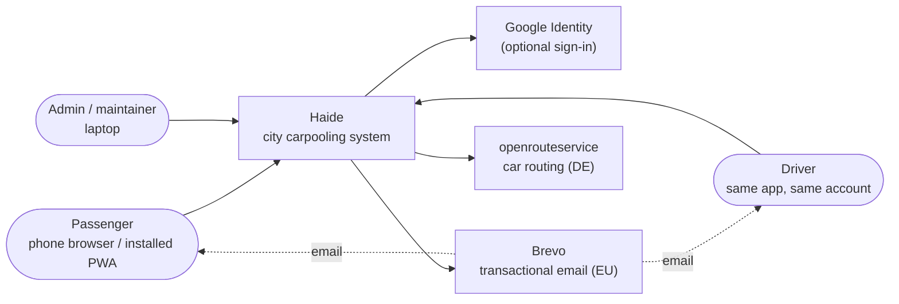
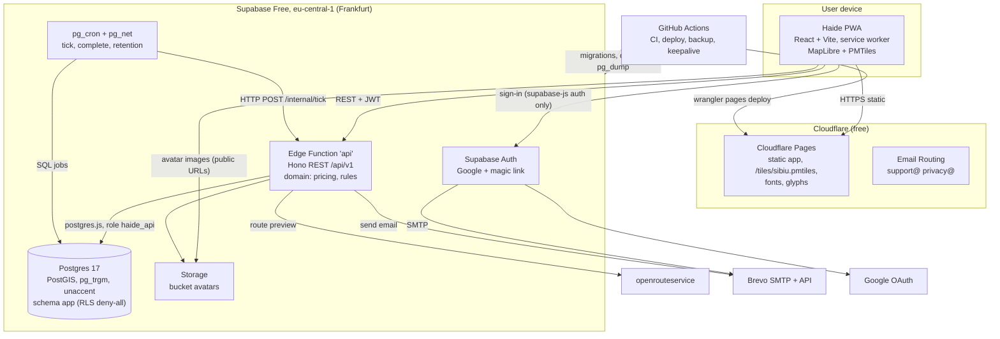
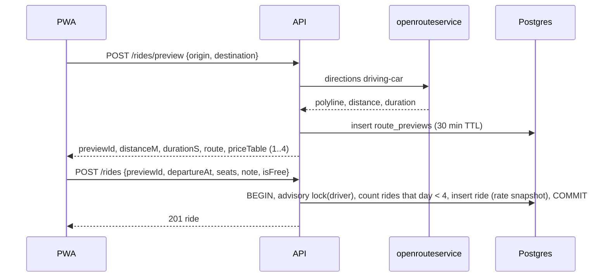
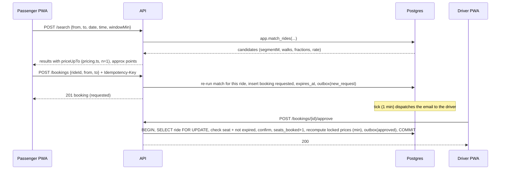
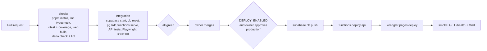

# Haide architecture

> Owner: software-architect · Date: 2026-11-15 · Status: Proposed (accepted when the Phase 3+4 PR is merged)
> ADRs: [0012 platform and stack](../decisions/0012-platform-and-application-stack.md) · [0013 hosting and CI](../decisions/0013-hosting-environments-and-ci.md) · [0014 maps, routing, geocoding](../decisions/0014-maps-routing-geocoding-providers.md) · [0015 route matching](../decisions/0015-route-matching-approach.md)
> Companion docs: [data-model.md](data-model.md) · [api-contract.md](api-contract.md) · [conventions.md](conventions.md) · [backlog-technical.md](backlog-technical.md) · [deploy.md](deploy.md) · [privacy-impact-assessment.md](privacy-impact-assessment.md)

## 1. Summary

| Concern | Decision |
|---|---|
| Platform | **Installable PWA**, mobile-first (360 px), no app stores |
| Frontend | React 19 + TypeScript + Vite, vite-plugin-pwa (Workbox), React Router 7, TanStack Query 5, Tailwind CSS v4 (tokens generated from `docs/brand/design-tokens.json`), i18next, react-hook-form + zod, MapLibre GL JS (lazy-loaded) |
| Backend | **Supabase Free, EU (Frankfurt)**: Postgres 17 + PostGIS, pg_trgm, unaccent, pg_cron, pg_net. One Edge Function **`api`** (Deno, Hono, zod, postgres.js) exposes a REST API. Pure TypeScript domain modules (pricing, booking rules) |
| Database access | Client → API only. Tables live in the non-exposed `app` schema with RLS deny-all. The API connects as the least-privilege role `haide_api` |
| Auth | Supabase Auth: Google OAuth + email magic link (PKCE, 15-min single-use). JWT verified in the API via JWKS. No SMS OTP in the MVP |
| Maps | MapLibre GL JS + **self-hosted Protomaps PMTiles extract of Sibiu** (same origin). Fallback: OpenFreeMap |
| Routing | **openrouteservice** `driving-car`, server-side only, once per ride preview (2,000/day free) |
| Geocoding | **Own gazetteer in Postgres** (OSM streets, POIs, addresses, neighbourhood areas) with unaccent + trigram search |
| Matching | PostGIS corridor + linear referencing, 800 m straight-line walk, O(log N + R·V) |
| Pricing | Pure TS module in `_shared/domain/pricing.ts`, integer money (bani), rate snapshot per ride |
| Email | Brevo (EU) free, 300/day: SMTP for auth mails, HTTP API for notifications via an outbox |
| Jobs | pg_cron: `tick` every minute (expire requests, complete rides, safety sweep, dispatch outbox, purge, coarsen locations, account purge, hourly retention; ADR 0024, 0029, 0030). No separate `retention` job |
| Hosting | Cloudflare Pages (PWA, `haide.ro`) + Supabase Free (API, DB, auth, storage) |
| CI/CD | GitHub Actions: lint, typecheck, unit, pgTAP, API integration, Playwright mobile E2E on every PR. Deploy gated by `DEPLOY_ENABLED` + an owner-approved `production` environment |
| Observability | Structured JSON logs (Supabase, 1 day), `app_errors` table (14 days), ops tiles on the admin page, twice-weekly health ping |
| Cost | **0 RON/month**. Domain about 50–100 RON/year **[A]** |

## 2. Platform choice: PWA

| Criterion | PWA | Native / Expo |
|---|---|---|
| Browse without account, share a ride link | A URL opens the ride directly | Needs deep links + install first |
| Cost | 0 | Apple 99 USD/year, store reviews |
| Install to home screen | Yes (Android prompt, iOS "Add to Home Screen") | Yes |
| Foreground geolocation ("use my location") | Yes | Yes |
| Push notifications | Android: yes. iOS: only for installed PWAs (iOS 16.4+). Push is an E8 Should anyway; email is the MVP channel | Yes |
| Background location | Not possible (and **not wanted**, ADR 0005 P2) | Possible |
| Agent productivity | One React codebase, Playwright-testable | Two build targets, device farms |

**Decision: PWA.** Nothing in the Must scope needs native APIs, and the privacy baseline actively forbids the one capability a PWA lacks (background location).

## 3. C4 diagrams

### 3.1 System context



### 3.2 Containers



### 3.3 Components inside `api`

| Component | Path | Responsibility |
|---|---|---|
| Router + middleware | `supabase/functions/api/index.ts`, `middleware/` | CORS, request id, JSON logging, auth (JWKS), rate limit, error mapping |
| Routes | `api/routes/*.ts` | Parse with zod (`_shared/contracts`), call a service, shape the response |
| Services | `api/services/*.ts` | Use cases: publishRide, requestBooking, approveBooking… Own the transactions |
| Repositories | `api/repo/*.ts` | SQL via postgres.js tagged templates. Map snake_case ↔ camelCase |
| Domain (pure) | `_shared/domain/*.ts` | Pricing, booking state machine, time rules, validation helpers, privacy rounding. No I/O |
| Providers | `_shared/providers/*.ts` | `RoutingProvider` (ors, fixture), `EmailProvider` (brevo, console), `Clock` |
| Serializers | `api/serializers/*.ts` | **Role-based field filtering** (public / requester / confirmed party / owner / admin) |

## 4. Key flows

### 4.1 Publish a ride



### 4.2 Search → request → approve



### 4.3 Background jobs

| Job | Schedule | Kind | What it does |
|---|---|---|---|
| `tick` | every minute | pg_net → `POST /internal/tick` (secret header) | (1) expire `requested` bookings past `expires_at` and enqueue emails. (2) Complete finished rides (E5). (3) Safety sweep (E5). (4) Send up to 50 pending outbox emails (retry with backoff, max 5 attempts). (5) Delete expired route previews and share links |
| ~~`complete-rides`~~ | moved into `tick` in E5 | | **Implemented in E5 (ADR 0024):** there is no separate cron job. `tick` step 2 calls `app.complete_rides(now, now − 2 h, 200)`: rides with `departure_at + 2 h ≤ now` become `completed` (confirmed bookings `completed`, `final_price_bani = price_locked_bani`) or `expired` when no booking was completed, with rating prompts queued in the same transaction. Rows locked by a concurrent writer are skipped until the next tick. Step 3 is the safety sweep (suspended users, blocked pairs; ADR 0027, 0028) and step 5 also deletes expired `share_links` |
| ~~`retention`~~ | moved into `tick` in E6 | | **Implemented in E6 (ADR 0030):** there is no separate cron job. `tick` step 6 runs `app.coarsen_locations(now, 500)` every minute (90-day coarsening), step 7 finishes account deletions (avatar object and auth user, with backoff, ADR 0029) and step 8 runs `app.run_retention()` hourly (SECURITY DEFINER: rate limits 2 d, app errors 14 d, outbox 30 d, analytics 13 months, reports 12 months, admin actions 24 months, consents of deleted accounts 3 years, completed deletions and fulfilled data requests 3 years) and raises an `app_errors` alarm for a deletion open over 7 days |
| `keepalive` | Tue + Fri (GitHub Actions) | HTTP | `GET /health`, keeps the free project active pre-launch |
| `backup` | daily 01:30 UTC (GitHub Actions) | pg_dump | `pg_dump --schema=app --table=auth.users --table=auth.identities` (session pooler, `SUPABASE_DB_PASSWORD`), gzip, encrypted with `age` to the owner's public key → 14-day artifact. Gazetteer tables excluded (reseedable) |

Why `tick` is an HTTP call: expiry emails and the outbox need the TypeScript email templates. A single per-minute invocation costs 43,200 of the 500,000 monthly invocations.

## 5. Route matching (ADR 0015)

**Inputs:** passenger origin O, destination T (WGS84), desired time t, window w ∈ {15, 30, 60} min, searcher id (nullable).

**Stored per ride:** `route` LineString 4326 (simplified at 10 m), generated `route_utm` (EPSG:32635), `distance_m` and `duration_s` from the router, `departure_at`, seats, status.

**Algorithm (`app.match_rides`):**

```
candidates  = rides WHERE status='published' AND departure_at ∈ [t−w, t+w]
              AND seats_booked < seats_offered AND driver_id ≠ searcher
              AND driver active AND no block either way              -- B-tree
              AND ST_DWithin(route_utm, O_utm, 800)
              AND ST_DWithin(route_utm, T_utm, 800)                    -- GiST
for each c:
  f_p  = ST_LineLocatePoint(c.route_utm, O_utm)
  sub  = ST_LineSubstring(c.route_utm, f_p, 1)                         -- only after pickup
  f_d  = f_p + (1 − f_p) · ST_LineLocatePoint(sub, T_utm)
  P'   = ST_LineInterpolatePoint(c.route_utm, f_p);  T' likewise at f_d
  walk_p = |O − P'|,  walk_d = |T − T'|                                -- metres, ≤ 800
  segment_m = round(c.distance_m · (f_d − f_p))                        -- ≥ 1000
  pickup_eta = departure_at + duration_s · f_p
keep f_d > f_p, walk_d ≤ 800, segment_m ≥ 1000
order by walk_p + walk_d, |departure_at − t|   limit 50
```

**Complexity:** O(log N + R) index range scan + O(R·V) geometry work (R = rides in the window, V ≤ 500 vertices). At pilot scale that is under 10 ms. The 800 m straight-line threshold is the documented proxy for 1 km walking (backlog E3-1 allows it). The constant `MAX_WALK_M = 800` lives in `_shared/domain/rules.ts` and is passed to SQL.

**What the passenger sees** (privacy, ADR 0005): `P'` and `T'` rounded to a **300 m grid cell centre** (deterministic, so repeated queries leak nothing new), area labels, walk distances rounded to 50 m, pickup ETA rounded to 5 min. The route geometry in public responses is **trimmed by min(500 m, 10 % of length) at both ends** and simplified at 25 m, so the driver's exact start and end are never drawn. Exact `P'`/`T'` are revealed only to the two parties of a confirmed booking until `departure_at + 24 h`.

**Booking re-check:** `POST /bookings` re-runs `match_rides` for that single ride with the passenger's points. The stored booking keeps only the snapped points, fractions, `segment_m`, walk distances and labels. The passenger's raw typed origin and destination are **not stored**.

## 6. Pricing engine (pricing.md, ADR 0003)

- **Location:** `supabase/functions/_shared/domain/pricing.ts`. Pure functions, integer arithmetic only, no I/O, no `Date.now()`.
- **Units:** money in **bani** (1 RON = 100 bani). Energy price in milli-RON per unit (`9810` = 9.81 RON/l). Reference consumption in centi-units per 100 km (`700` = 7.00 l/100 km). Distance in metres.

```ts
// rate in micro-RON per km: consumption(l/100km) / 100 × price(RON/l)
ratePerKmMicro(consumptionCenti, priceMilli) = floor(consumptionCenti × priceMilli / 10)     // 700×9810/10 = 686_700
segmentCostMicro(segmentM, rateMicro)       = floor(segmentM × rateMicro / 1000)            // ≤ 4e10, safe integer
seatPriceBani(segmentM, rateMicro, n, isFree) =                                             // n = confirmed incl. this passenger
  isFree ? 0 : floor(segmentCostMicro / (n + 1) / 100_000) × 10                             // round DOWN to 0.10 RON
quoteUpTo(segmentM, rateMicro, isFree)      = seatPriceBani(segmentM, rateMicro, 1, isFree) // "Up to X RON" (alone with driver)
relock(oldLockedBani, newPriceBani)         = min(oldLockedBani, newPriceBani)              // price only goes down
priceTable(routeM, rateMicro, maxSeats)     = [n=1..maxSeats] → seatPriceBani(routeM, rateMicro, n)
```

- **Rate snapshot:** at publish time the ride stores `energy_price_id` and `rate_micro_per_km`. Later config changes never alter a published ride (pricing §3 update rule).
- **When prices change:** only inside the approve transaction (n grows, so everyone is relocked with `min`). Cancellations recompute too, but `min` keeps old values by construction (E4-4, E4-7). `final_price_bani` is copied from `price_locked_bani` by `complete-rides`. Confirm and cancel are impossible after departure, so the locked value at departure is final.
- **Guaranteed upper bound:** the price shown at search and request time is `quoteUpTo` (n = 1). Any confirmed price is ≤ it, so "Up to X RON" is always true.
- **Verified against pricing.md §5** (with the exact rate 0.6867, not the displayed 0.687): Trip A 3.90 / 2.60 / 1.90. Trip B 3.10 / 2.00 / 1.50. Trip C 1.40 / 0.90 / 0.70. Mixed P1 2.60, P2 1.20. These are test fixtures (E2-5a).
- **Tests (required):** worked examples to the exact bani. fast-check property tests: Σ prices ≤ n/(n+1) × trip cost; each price ≤ segment cost / 2; every price is a multiple of 10 bani; relock never increases. DB `CHECK (price % 10 = 0)` and `price_locked ≤ price_quoted`.
- **Guardrails enforced server-side:** max 4 seats, max 4 rides per driver per Europe/Bucharest calendar day (advisory lock + count in the transaction), departure 15 min to 14 days ahead, route 1–40 km, segment ≥ 1 km, no price input exists in the API.

## 7. Booking state machine and concurrency

States: `requested → confirmed | rejected | expired | cancelled`; `confirmed → completed | cancelled | no_show`; `completed → no_show` (only until `departure_at + 24 h`, because auto-completion runs at +2 h). The transition table lives in `_shared/domain/booking.ts` (`canTransition(from, to, ctx)`) and is unit-tested exhaustively.

| Guard | Where |
|---|---|
| One active booking per passenger per ride | Partial unique index `(ride_id, passenger_id) WHERE status IN ('requested','confirmed')` |
| No overbooking | `SELECT … FOR UPDATE` on the ride row in the approve transaction + `CHECK (seats_booked BETWEEN 0 AND seats_offered)` as the last line of defence. A concurrency integration test fires parallel approvals for the last seat: exactly one succeeds, the rest get `409 RIDE_FULL` |
| Expired requests cannot be approved | Approve checks `expires_at > now()` inside the transaction (also covers the up-to-1-minute lag of `tick`) |
| Request closes 10 min before departure | Service check. `expires_at = least(created_at + 30 min, departure_at − 10 min)` |
| Idempotent request creation | `Idempotency-Key` header stored in `bookings.idempotency_key` (unique per passenger). The offline queue in the PWA reuses the key on retry |

## 8. Auth and authorization

- **Sign-in:** supabase-js in the PWA is used **only for auth** (`signInWithOAuth({provider:'google'})`, `signInWithOtp({email})`, PKCE, session refresh). Email OTP expiry = 900 s, links single-use. Redirect URL: `https://haide.ro/auth/callback`.
- **API auth:** `Authorization: Bearer <access_token>`. Middleware verifies the token with `jose` against the project JWKS (`/auth/v1/.well-known/jwks.json`, cached), checks `aud = authenticated`, and loads the `profiles` row. The function is deployed with `verify_jwt = false`, because public routes must work signed out.
- **Gates (server-side, in this order):** `UNAUTHENTICATED` (401) → `ACCOUNT_SUSPENDED` / `ACCOUNT_DELETED` (403) → `CONSENT_REQUIRED` (403, current ToS/privacy versions not accepted) → `PROFILE_INCOMPLETE` (403) → `VEHICLE_REQUIRED` (403, publish only) → resource authorization (404 for resources you may not see, never 403, so existence does not leak).
- **Roles:** `profiles.role ∈ {user, admin}`. Admin is granted by SQL only (`update app.profiles set role='admin' where id=…`, documented in deploy.md). **Implemented in E7 (ADR 0033):** `requireAdmin` (`middleware/gates.ts`) needs an active account and `role = 'admin'`, **re-read from the database on every request** (so a revoked role or a suspension applies at once); all `/admin/*` routes share it and one rate limit (`admin`, 120 per minute). Every admin write is one transaction with one audited SQL function and its `admin_actions` row; no endpoint grants or revokes the role; an admin cannot suspend themselves; no admin response holds a phone, plate, email or coordinate. No MFA in the MVP (revisit trigger in ADR 0033).
- **Database privileges:** the API connects with `API_DB_URL` as role `haide_api` (DML on `app.*`, EXECUTE on `app` functions, no DDL, no access to `auth` except `auth.users` deletion through the Admin API with the secret key). `anon` and `authenticated` have **no grants** on schema `app`, and RLS is enabled with no policies (deny-all), so the public publishable key cannot read anything. The full authorization matrix is in [data-model.md §5](data-model.md#5-authorization).

## 9. Privacy implementation (ADR 0005, strategy P1–P10)

| Checkpoint | Implementation |
|---|---|
| P2 no background tracking | `navigator.geolocation.getCurrentPosition` only on the "Use my location" tap. No `watchPosition`. The service worker never touches location |
| P3 precision by role | Serializers per audience. Public: 300 m grid points, area labels, trimmed route. Exact points only to the driver (own ride) and confirmed parties until `departure_at + 24 h`. Search and match coordinates go in **POST bodies**, never URLs, so they never land in access logs |
| P4 contact window | `phone` and `plate` serialized only when `booking.status ∈ {confirmed, completed}` and `now() < departure_at + 24 h`. Never in emails, events or logs |
| P5 retention | **Implemented in E6 (ADR 0030): `tick` step 6, `app.coarsen_locations`** (see §4.3). Original plan: `retention` job: rides/bookings with `departure_at < now() − 90 days` get points replaced by 1 km grid centroids, `route`/`route_utm` set to NULL, labels set to the area name, `coarsened_at` set. Events 13 months, reports 12 months, outbox 30 days, errors 14 days. pgTAP test: no exact geometry older than 90 days |
| P6 deletion | `DELETE /me`: cancel future rides and bookings (with notifications), delete the vehicle, avatar object and push subscriptions, null phone/bio/photo, set first name to NULL (rendered "Deleted user"), `status='deleted'`, coarsen the user's past rides and bookings immediately, null `user_id` in analytics events, delete the `auth.users` row via the Admin API. Reports **about** the user keep their snapshot for 12 months (legitimate interest). Backups age out in ≤ 14 days, inside the 30-day promise |
| P7 transparency | `legal_documents` (kind, version, published_at). `consents` rows (user, kind, version, timestamp). A version bump forces re-acceptance (`CONSENT_REQUIRED`) |
| P8 processors | Supabase (EU, Frankfurt), Cloudflare (CDN, global), Brevo (FR), HeiGIT/openrouteservice (DE, coordinates only), Google (only if the user picks Google sign-in). Listed in the privacy policy and the DPIA |
| Photos | The client resizes to ≤ 1024 px and re-encodes via canvas (drops EXIF). The API accepts ≤ 1.5 MB, checks magic bytes, decodes and **re-encodes to 512×512 JPEG** (server-side EXIF/GPS guarantee), and stores `avatars/{uuid}.jpg` (random name, public bucket) |
| Fonts | Self-hosted with `latin-ext` (brand-guide §4) |
| Analytics | Own `analytics_events` table. Payloads hold ids, area labels and counts only, and **the database refuses anything else** (E7, ADR 0032: `app.event_props_ok` CHECK, flat props, an allow-list of keys per event in `_shared/domain/events.ts`). No third-party analytics, no cookies beyond the auth session in `localStorage`. Metrics (E7, ADR 0034) are computed on read by STABLE SQL functions over `bookings`, `rides` and the events, in `_shared/domain/metrics.ts`; no rollup tables |

Full risk analysis: [privacy-impact-assessment.md](privacy-impact-assessment.md).

## 10. Notifications

- **Outbox pattern:** every state change inserts `outbox` rows in the **same transaction** (template, recipient user id, payload with labels and times only). `tick` sends them through `EmailProvider` (Brevo HTTP API) and marks them `sent` or `failed` (exponential backoff, 5 attempts). Delivery is under 2 min (E4-6). Templates are TS functions using i18n strings from `_shared/i18n/en.json`.
- **Badges:** `GET /me/summary` (pending requests as driver, unseen booking changes as passenger), polled every 60 s while the app is visible and on focus. No Realtime in the MVP.
- **Web push (E8-4):** VAPID keys in function secrets, `push_subscriptions` table, sent from `tick` with the same outbox rows (`channel='push'`). Email stays the fallback.
- **Volume estimate:** about 85 emails/day average at pilot targets, vs a 300/day free cap. `tick` stops sending at 280/day and keeps the rest pending for after midnight UTC; magic links (SMTP) are never blocked.

## 11. Frontend architecture

- **Routing:** path routes (Pages serves `index.html` for unknown paths). Tabs: `/find`, `/offer`, `/rides`, `/profile`, mirroring the prototype routes in ia-and-flows §4.
- **Data:** TanStack Query per resource (`useRide`, `useSearch`…), query keys in `src/api/keys.ts`, a fetch wrapper in `src/api/client.ts` that adds the JWT, parses the error envelope into `ApiError(code)`, and maps the code to the i18n key `errors.<CODE>`.
- **Offline:** the service worker precaches the app shell, fonts, glyphs and the PMTiles file (runtime cache, range requests). API responses are never cached by the service worker. "Send request" while offline goes to an IndexedDB queue with its idempotency key and is flushed on `online` (F3 M1).
- **Maps:** `<RouteMap mode="approximate|exact">` wraps MapLibre and is code-split (`React.lazy`), so Find and Results load without it. It provides a text alternative (accessibility.md open item 2) and `maxBounds` = Sibiu bbox.
- **Return-to-intent after sign-in:** the intended path and action are stored in `sessionStorage` before onboarding and restored after (ADR 0010).
- **i18n:** all strings in `apps/web/src/i18n/en.json` (keys from `docs/ux/copy.md`). `Intl` for money (`3.90 RON`, `tabular-nums`) and Europe/Bucharest times.
- **Performance budget:** initial JS ≤ 200 KB gzip without the map chunk. Lighthouse PWA and accessibility ≥ 90 on Find (CI floor).

## 12. CI/CD



- **Workflows:** `ci.yml` (PR + push to main), `deploy.yml` (push to main + manual), `backup.yml` (nightly), `keepalive.yml` (twice weekly), Dependabot (weekly, grouped).
- **Required checks for merge:** `checks`, `integration`. Estimated 8–10 min per PR run.
- **Migrations:** forward-only SQL in `supabase/migrations/` (timestamped). Never edit a merged migration. Every migration must pass `supabase db reset` in CI.

## 13. Testing strategy

| Layer | Tool | Scope | Gate |
|---|---|---|---|
| Unit (domain) | Vitest + fast-check | pricing, booking transitions, time rules (15 min / 14 days / 10 min / 30 min / 24 h, Europe/Bucharest day), phone/plate normalisation, grid rounding, route trimming | ≥ 90 % line coverage of `_shared/domain` |
| Unit (web) | Vitest + Testing Library + MSW | hooks, forms, error mapping, components with states (empty/loading/error/success) | Must pass |
| Database | pgTAP (`supabase test db`) | constraints, `match_rides` on fixture polylines (trips A, B, C + a loop + a reverse-direction case), retention coarsening, expiry, completion, grants (anon/authenticated have no access) | Must pass |
| API integration | Vitest against local stack (`supabase functions serve`, `ROUTING_PROVIDER=fixture`, `EMAIL_PROVIDER=console`) | every endpoint: happy path + auth + validation + main error codes. Role-based field filtering (no exact coordinates, phone or plate leaks). Parallel-approval overbooking test | Must pass |
| E2E | Playwright, Chromium, viewport 360×800, `@axe-core/playwright` | one happy path per epic (G3) + axe on Find, Results, Ride detail, Booking | Must pass, no serious or critical axe violations |
| Manual (pre-launch) | qa-reviewer | screen readers, 200 % zoom (accessibility.md §7) | Gate 3 checklist |

Test data: `supabase/seed.sql` (gazetteer sample + energy prices v1), `supabase/tests/fixtures/routes/*.geojson` (real Sibiu polylines), factories in `tests/integration/factories.ts`. No test hits a third-party network.

## 14. Observability

| Signal | Where | Retention |
|---|---|---|
| API logs: one JSON line per request (`reqId`, route template, status, ms, user id hash) | Supabase function logs | 1 day (free) |
| Errors: server unhandled + client `window.onerror` / React error boundary via `POST /telemetry/error` | `app_errors` table, shown on the admin page | 14 days |
| Job health: `cron.job_run_details`, outbox backlog, failed sends, emails sent today vs 300 | Admin "Ops" tile | — |
| Quotas: DB size (`pg_database_size`), ORS calls today, emails today | Admin "Ops" tile. Manual monthly check of egress and invocations in the Supabase dashboard | — |
| Uptime | `keepalive.yml` (fails the workflow and emails the owner via GitHub if `/health` ≠ 200) | — |

Logs never contain coordinates, phone numbers, plates, emails or tokens (lint rule plus a review checklist item).

## 15. Security

| Threat | Control |
|---|---|
| Data exfiltration via the public key | `app` schema not exposed, RLS deny-all, no grants for anon/authenticated. A pgTAP test asserts this |
| Broken object-level auth | Every service loads resources scoped to the caller (`where driver_id = $me` / booking party check). Integration tests per endpoint for "other user" → 404 |
| Injection | postgres.js tagged templates only (no string-built SQL). zod at every boundary |
| Price tampering | No price fields accepted. Server computes from the stored segment and rate snapshot |
| Abuse / scraping / location probing | Postgres-backed fixed-window rate limits: search 30/min per user or IP hash, places 60/min, booking requests 10/hour, reports 10/day, auth emails per Supabase limits. IP hashed with a daily rotating salt, never stored raw |
| XSS | React escaping, no `dangerouslySetInnerHTML`. CSP via Pages `_headers`: `default-src 'self'; connect-src 'self' https://<ref>.supabase.co; img-src 'self' data: blob: https://<ref>.supabase.co; worker-src 'self' blob:; style-src 'self' 'unsafe-inline'; frame-ancestors 'none'` |
| CSRF | Bearer tokens in headers (no cookies). CORS allow-list: `https://haide.ro`, `http://localhost:5173` |
| Malicious uploads | Size cap, magic bytes, full re-encode, random object names |
| Secrets | GitHub secrets, Supabase function secrets, never in git (`.env` gitignored, `.env.example` maintained). The repo's PreToolUse secret scanner stays on |
| Cron endpoint | `/internal/*` requires `x-cron-secret` (stored in Supabase Vault and function secrets) |
| Dependencies | `pnpm audit --prod --audit-level=high` in CI, Dependabot |
| Admin actions | `admin_actions` audit table (who, what, target, when) |
| Share links (E5-6) | 128-bit random token, only its SHA-256 stored, expires at `departure_at + 24 h` |

## 16. Capacity vs free tier (pilot: 500 users, 200 rides/week)

| Resource | Free limit (checked 2026-11-15) | Estimate | Headroom |
|---|---|---|---|
| Supabase DB | 500 MB | < 200 MB (routes coarsened after 90 days, gazetteer about 20 MB) | 2.5× |
| Edge Function invocations | 500,000/month | about 225,000 (API about 180k + tick 43k) | 2.2× |
| Supabase egress | 5 GB + 5 GB cached | about 1.5–2 GB (JSON) + avatars 256 px via cached egress | 2.5× |
| Storage | 1 GB | 500 avatars × 40 KB = 20 MB | 50× |
| Auth MAU | 50,000 | 500 | 100× |
| Brevo email | 300/day | about 85/day average | 3.5× |
| openrouteservice | 2,000/day, 40/min | < 100/day | 20× |
| Cloudflare Pages | 500 builds/month, 25 MiB per file | about 60 deploys/month, PMTiles < 25 MiB | — |
| GitHub Actions (if private) | about 2,000 Linux min/month | about 500 | 4× |

## 17. Risks and revisit triggers

| Risk | Mitigation / trigger |
|---|---|
| Supabase changes the free plan or pauses the project | Keep-alive, nightly encrypted backups, plain Postgres + SQL migrations (portable to any Postgres with PostGIS). Pro is 25 USD/month if needed |
| ORS outage | Publishing degrades with a clear error. Search and booking are unaffected. Manual switch to a backup provider via `ROUTING_PROVIDER` |
| PMTiles extract too large or stale | maxzoom 14 + overzoom. Quarterly refresh script. OpenFreeMap fallback via env |
| Edge Function cold starts | One fat function keeps it warm. Pin the region with the `x-region: eu-central-1` header if logs show cross-region calls |
| Email deliverability | Domain authentication (SPF, DKIM, DMARC) in Brevo before launch. Plain-text + simple HTML templates |
