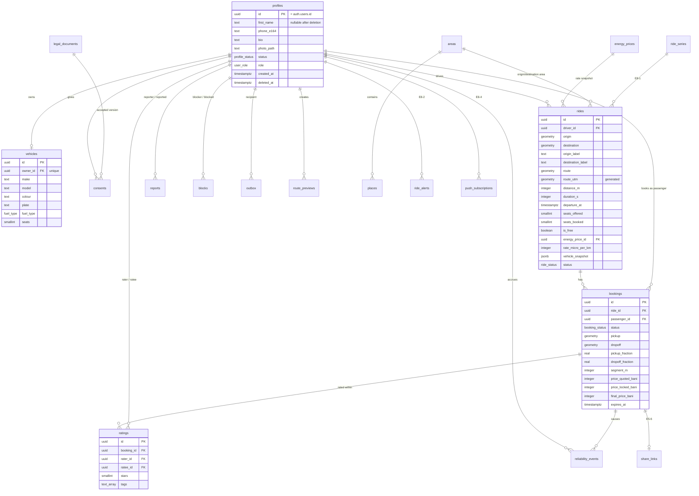

# Data model

> Owner: software-architect · Date: 2026-11-15 · Database: Supabase Postgres 17 + PostGIS · Schema: `app` (not exposed through the Data API)
> Related: [architecture.md](architecture.md) · [api-contract.md](api-contract.md) · ADRs [0005](../decisions/0005-location-privacy-baseline.md), [0012](../decisions/0012-platform-and-application-stack.md), [0015](../decisions/0015-route-matching-approach.md)

## 1. Conventions

- Tables and columns in `snake_case`, plural table names. Primary keys are `uuid` (`gen_random_uuid()`), except `analytics_events` and `rate_limits` (`bigint` identity).
- Timestamps are `timestamptz`, stored UTC, named `*_at`. Display timezone is Europe/Bucharest (G4).
- Money: `integer` **bani**, named `*_bani`. Every price column has `CHECK (x >= 0 AND x % 10 = 0)`.
- Geometry: `geometry(Point|LineString, 4326)`. A generated UTM 35N copy (`EPSG:32635`) exists where metric operations are indexed.
- Enums are Postgres `enum` types (listed in §3). Adding values is a migration.
- Text is UTF-8. Search columns use `app.immutable_unaccent(lower(...))`, a wrapper marked IMMUTABLE so it can be indexed.
- Extensions: `postgis`, `pg_trgm`, `unaccent`, `pg_cron`, `pg_net`, `pgtap` (tests only), `supabase_vault`.

## 2. ER diagram

## 3. Enum types

| Type | Values |
|---|---|
| `profile_status` | `active`, `suspended`, `deleted` |
| `user_role` | `user`, `admin` |
| `fuel_type` | `petrol`, `diesel`, `lpg`, `hybrid`, `electric` |
| `ride_status` | `published`, `cancelled`, `completed`, `expired` |
| `booking_status` | `requested`, `confirmed`, `rejected`, `expired`, `cancelled`, `completed`, `no_show` |
| `consent_kind` | `terms`, `privacy`, `age_18` |
| `report_reason` | `no_show`, `unsafe_driving`, `harassment`, `extra_money`, `fake_profile`, `other` |
| `report_status` | `open`, `dismissed`, `actioned` |
| `reliability_kind` | `late_cancellation`, `no_show` |
| `outbox_status` | `pending`, `sent`, `failed` |
| `notify_channel` | `email`, `push` |

## 4. Tables

### 4.1 Accounts (E1)

**`profiles`**: one row per auth user, created by trigger `on auth.users insert`. **No foreign key to `auth.users`**, so the tombstone survives auth-user deletion.

| Column | Type | Constraints / notes |
|---|---|---|
| id | uuid PK | equals `auth.users.id` |
| first_name | text | DB: `CHECK (char_length(first_name) BETWEEN 1 AND 30)`. Letter rule (Unicode letters, space, hyphen, apostrophe: `/^\p{L}[\p{L} '\-]{0,29}$/u`) enforced in the domain/zod layer. NULL only when deleted |
| phone_e164 | text | `CHECK (phone_e164 ~ '^\+40[0-9]{9}$')`. Romanian mobile validation (`+407…`) in the domain |
| bio | text | `CHECK (char_length(bio) <= 200)` |
| photo_path | text | storage object key `avatars/<uuid>.jpg` |
| status | profile_status | default `active` |
| role | user_role | default `user` |
| created_at, updated_at | timestamptz | |
| deleted_at | timestamptz | set on deletion |
| last_seen_summary_at | timestamptz | for passenger "unseen updates" badge |

Profile completeness (derived): `first_name AND phone_e164 AND photo_path IS NOT NULL`.

**`vehicles`**

| Column | Type | Constraints |
|---|---|---|
| id | uuid PK | |
| owner_id | uuid FK → profiles | **UNIQUE** (one vehicle per user), `ON DELETE CASCADE` |
| make, model, colour | text | `char_length BETWEEN 1 AND 30` |
| plate | text | normalised uppercase without spaces or dashes, `CHECK (plate ~ '^[A-Z0-9]{4,10}$')` |
| fuel_type | fuel_type | |
| seats | smallint | `CHECK (seats BETWEEN 1 AND 4)` |
| created_at, updated_at | timestamptz | |

**`legal_documents`**: `id`, `kind consent_kind` (terms/privacy), `version text`, `published_at`, `url text`. UNIQUE `(kind, version)`. The current version is the latest `published_at ≤ now()` per kind.

**`consents`**: `id`, `user_id uuid` (no FK, kept 3 years after deletion as proof), `kind consent_kind`, `document_version text` (NULL for `age_18`), `accepted_at`. Index `(user_id, kind, accepted_at desc)`.

### 4.2 Pricing config (E2-5, E7-4)

**`energy_prices`**: **immutable rows** (UPDATE and DELETE revoked from `haide_api`; new versions only).

| Column | Type | Notes |
|---|---|---|
| id | uuid PK | |
| fuel_type | fuel_type | |
| price_milli | integer | milli-RON per litre or kWh (9810 = 9.81 RON/l). `CHECK (> 0)` |
| consumption_centi | integer | per 100 km × 100 (700 = 7.00 l/100 km). `CHECK (> 0)` |
| unit | text | `CHECK (unit IN ('l','kWh'))` |
| effective_from | timestamptz | UNIQUE `(fuel_type, effective_from)` |
| source_note | text | e.g. "National average 10 Nov 2026, Playtech/PretCarburant" |
| created_by | uuid | admin, NULL for seed |
| created_at | timestamptz | |

Seed v1 (effective 2026-11-15, from pricing.md §3): petrol 9810/700 l · diesel 10850/600 l · lpg 4760/900 l · hybrid 9810/500 l · electric 1400/1700 kWh.

**Rules for a new version (E7-4, ADR 0035; enforced by `services/energyPrices.ts` and `_shared/domain/energyPrices.ts`, not by the table):** append-only and forward-only per fuel: `effective_from` is later than the latest row of that fuel (in force or scheduled), at most 5 minutes in the past and 30 days ahead, truncated to the minute. `price_milli` is 100 to 50 000 and `consumption_centi` 100 to 5 000. The unit follows the fuel type (electric is kWh). A change of more than 30 % in price **or** consumption from the latest row needs `overrideLargeChange` (integer math: exactly 30 % passes). `source_note` is required (1 to 200 characters). The insert runs under `pg_advisory_xact_lock(hashtext('app.energy_prices'))`, sets `created_by` to the admin and writes an `admin_actions` row `energy_price_added`. Published rides keep their `energy_price_id` and `rate_micro_per_km` snapshot; `energyPriceFor()` picks the row in force at publish time, so a scheduled row needs no job. A mistaken scheduled row is deleted in the SQL editor before it takes effect (deploy.md §6).

### 4.3 Rides (E2)

**`route_previews`** (TTL 30 min): `id`, `driver_id`, `origin geometry(Point)`, `destination geometry(Point)`, `origin_label text`, `destination_label text` (1 to 80 chars, NOT NULL: the labels shown to the driver, copied to the ride on publish), `route geometry(LineString)` (simplified at 10 m on insert), `distance_m`, `duration_s`, `provider text` (`ors` or `fixture`), `created_at`, `expires_at` (`CHECK (expires_at > created_at)`). Indexes `(expires_at)` and `(driver_id)`.

**`energy_prices`** (immutable config, seeded with v1 in the E2 migration, not in `seed.sql`): `id`, `fuel_type`, `price_milli` (milli-RON per l or kWh), `consumption_centi` (per 100 km, x100), `unit` (`l` or `kWh`, `CHECK ((fuel_type = 'electric') = (unit = 'kWh'))`), `effective_from`, `source_note`, `created_by`, `created_at`. `UNIQUE (fuel_type, effective_from)`. `haide_api` has no UPDATE or DELETE: a new price is a new row.

**`rides`**

| Column | Type | Constraints / notes |
|---|---|---|
| id | uuid PK | |
| driver_id | uuid FK → profiles | `ON DELETE RESTRICT` (tombstones never deleted) |
| series_id | uuid FK → ride_series NULL | E8-1 |
| origin, destination | geometry(Point,4326) | exact, coarsened after 90 days |
| origin_label, destination_label | text | short label, e.g. "Cisnădie, Str. Măgurii". Becomes the area name when coarsened |
| origin_area_id, destination_area_id | uuid FK → areas | |
| route | geometry(LineString,4326) NULL | simplified 10 m. NULL after coarsening |
| route_utm | geometry(LineString,32635) | `GENERATED ALWAYS AS (ST_Transform(route, 32635)) STORED` |
| distance_m | integer | `CHECK (distance_m BETWEEN 1000 AND 40000)` |
| duration_s | integer | `CHECK (> 0)` |
| departure_at | timestamptz | 15 min to 14 days ahead (API check, not a CHECK, because `now()` is not immutable) |
| seats_offered | smallint | `CHECK (seats_offered BETWEEN 1 AND 4)` |
| seats_booked | smallint | default 0, `CHECK (seats_booked BETWEEN 0 AND seats_offered)`, the overbooking backstop |
| note | text | `≤ 200` chars |
| is_free | boolean | default false (E2-6) |
| auto_accept | boolean | default false (E8-3) |
| energy_price_id | uuid FK → energy_prices | snapshot |
| rate_micro_per_km | integer | snapshot of `floor(consumption_centi × price_milli / 10)` |
| vehicle_snapshot | jsonb | `{make, model, colour, plate, fuelType}` at publish time. Plate scrubbed on account deletion and coarsening |
| status | ride_status | default `published` |
| cancelled_at | timestamptz | |
| late_cancel | boolean | default false. True if cancelled within 30 min of departure |
| completed_at | timestamptz | |
| coarsened_at | timestamptz | |
| created_at, updated_at | timestamptz | |

Named constraints: `rides_seats_booked_range` (`seats_booked BETWEEN 0 AND seats_offered`, the overbooking backstop: E4 maps a violation to `RIDE_FULL`), `rides_cancelled_has_time` (`status <> 'cancelled' OR cancelled_at IS NOT NULL`), `rides_late_cancel_only_cancelled` (`NOT late_cancel OR status = 'cancelled'`). The route helper functions `app.simplify_route(geometry, integer)` and `app.public_route(geometry)` (trim `min(500 m, 10 %)` at both ends, then simplify at 25 m) are IMMUTABLE, STRICT and executable by `haide_api` only.

Indexes:
- `rides_published_departure_idx` B-tree `(departure_at) WHERE status = 'published'`: search prefilter.
- `rides_route_utm_gix` GiST `(route_utm) WHERE status = 'published'`: corridor filter.
- `rides_driver_departure_idx` `(driver_id, departure_at DESC)`: my rides, daily limit.
- `rides_completion_idx` `(departure_at) WHERE status = 'published'` (shared with the first).
- `rides_coarsen_idx` `(departure_at) WHERE coarsened_at IS NULL`.

### 4.4 Bookings (E3, E4, E5)

**`bookings`**

| Column | Type | Constraints / notes |
|---|---|---|
| id | uuid PK | |
| ride_id | uuid FK → rides | `ON DELETE RESTRICT` |
| passenger_id | uuid FK → profiles | |
| status | booking_status | default `requested` |
| pickup, dropoff | geometry(Point,4326) | **snapped points on the route** (exact). Coarsened after 90 days |
| pickup_label, dropoff_label | text | area / street label |
| pickup_area_id, dropoff_area_id | uuid FK → areas | |
| pickup_fraction, dropoff_fraction | double precision | `CHECK (0 <= pickup_fraction AND pickup_fraction < dropoff_fraction AND dropoff_fraction <= 1)` |
| segment_m | integer | `CHECK (segment_m >= 1000)` |
| walk_pickup_m, walk_dropoff_m | integer | `CHECK (BETWEEN 0 AND 800)` |
| price_quoted_bani | integer | `quoteUpTo` at request time (n = 1) |
| price_locked_bani | integer NULL | set on confirm, only decreases. `CHECK (price_locked_bani <= price_quoted_bani)` |
| final_price_bani | integer NULL | set at completion |
| idempotency_key | text NULL | UNIQUE `(passenger_id, idempotency_key)` |
| requested_at | timestamptz | |
| expires_at | timestamptz | `least(requested_at + 30 min, departure_at − 10 min)` |
| decided_at | timestamptz | approve/reject time (median response metric) |
| cancelled_at | timestamptz | |
| cancelled_by | text | `CHECK (cancelled_by IN ('passenger','driver','system'))` |
| late_cancel | boolean | default false |
| no_show_at | timestamptz | |
| no_show_by | text | `'driver'` (passenger didn't show) or `'passenger'` (driver didn't show) |
| seen_by_passenger_at | timestamptz | for badges |
| passenger_event_at | timestamptz NULL | **E4.** Last change the passenger did not cause (confirmed, rejected, expired, cancelled by the driver, price dropped). Unseen = `passenger_event_at > coalesce(seen_by_passenger_at, '-infinity')`. `profiles.last_seen_summary_at` is no longer used (dropped in E6) |
| coarsened_at | timestamptz | |
| created_at, updated_at | timestamptz | |

**Implemented in E4** (`20261119090000_bookings.sql`): the table and its named constraints exactly as above (`bookings_fractions`, `bookings_segment_min`, `bookings_price_nonneg`, `bookings_lock_le_quote`, `bookings_final_le_lock`, `bookings_locked_when_confirmed`, `bookings_decided_has_time`, `bookings_cancelled_has_meta`, `bookings_late_only_cancelled`, `bookings_expiry_after_request`, `bookings_idempotency_uniq`), RLS enabled with no policies, `DELETE` revoked from `haide_api`. **`pickup_label` and `dropoff_label` are area names** (`app.area_for` of the exact snapped point), safe for emails, lists and every viewer. `pickup`/`dropoff` hold the exact points on the route (`ST_LineInterpolatePoint(route_utm, fraction)` back to 4326), shown only through `revealFor`. The foreign keys that were waiting for this table are added: `reliability_events.booking_id`, `reliability_events.ride_id` and `ratings.booking_id`. Invariant: `rides.seats_booked = count(bookings WHERE status = 'confirmed')` at all times, also for a cancelled ride (ride cancel sets it to 0); the CHECK `rides_seats_booked_range` is the backstop (`23514` → `RIDE_FULL`). New functions (all with PUBLIC EXECUTE revoked): `app.expire_requests(timestamptz)`, `app.outbox_recipients(uuid[])` (SECURITY DEFINER, the only path to `auth.users` emails) and `app.call_tick()` (SECURITY DEFINER, reads `api_tick_url` and `cron_secret` from Vault and does nothing when they are missing; pg_cron job `haide-tick`, every minute). Ride row lock first, then guarded booking updates (ADR 0021).

Note: when a passenger reports "driver didn't show", the booking moves to `no_show` with `no_show_by='passenger'`, and a `reliability_events(no_show)` row is created **for the driver**.

Indexes:
- `bookings_one_active_uidx` UNIQUE `(ride_id, passenger_id) WHERE status IN ('requested','confirmed')`.
- `bookings_ride_status_idx` `(ride_id, status)`.
- `bookings_passenger_idx` `(passenger_id, requested_at DESC)`.
- `bookings_expiry_idx` `(expires_at) WHERE status = 'requested'`.
- `bookings_coarsen_idx` `(created_at) WHERE coarsened_at IS NULL`.

### 4.5 Trust and safety (E5)

**`ratings`**

| Column | Type | Constraints |
|---|---|---|
| id | uuid PK | |
| booking_id | uuid FK → bookings | |
| rater_id, ratee_id | uuid FK → profiles | `CHECK (rater_id <> ratee_id)` |
| stars | smallint | `CHECK (stars BETWEEN 1 AND 5)` |
| tags | text[] | each ∈ allowed set (domain check). `CHECK (cardinality(tags) <= 5)` |
| created_at | timestamptz | |

UNIQUE `(booking_id, rater_id)`. Immutable (no UPDATE/DELETE grants). Index `(ratee_id, created_at)`. **Visibility** (computed in the query): visible to the ratee when the counter-rating exists on the same booking **or** `now() > ride.completed_at + 7 days`. Average shown only when ≥ 3 visible ratings.

**`reliability_events`**: `id`, `user_id`, `kind reliability_kind`, `booking_id NULL`, `ride_id NULL`, `occurred_at`. Index `(user_id, occurred_at)`. The profile shows counts where `occurred_at > now() − 90 days`.

**`reports`**: `id`, `reporter_id`, `reported_id`, `ride_id NULL`, `booking_id NULL`, `reason report_reason`, `details text (≤ 500)`, `reported_snapshot jsonb` (`{firstName, phoneE164}` at report time, for safety follow-up), `status report_status`, `created_at`, `resolved_at`, `resolved_by`. Index `(status, created_at)`. Deleted after 12 months.

**`blocks`**: PK `(blocker_id, blocked_id)`, `created_at`, `CHECK (blocker_id <> blocked_id)`. Index `(blocked_id)` for the reverse lookup. Created in E3 (migration `20261118090000_search.sql`) because the match filter reads it; RLS enabled with no policies, no access for `anon`/`authenticated`. The endpoints that write it arrive with E5.

**Implemented in E5** (`20261120090000_trust_safety.sql`): `POST /blocks` and `DELETE /blocks/{userId}` write it. A block never deletes history: it cancels active future bookings between the pair (ADR 0028).

**`share_links`** (E5-6): `id`, `booking_id`, `token_hash bytea UNIQUE`, `created_by`, `expires_at`, `created_at`.

**`admin_actions`**: `id`, `admin_id`, `action text` (`CHECK IN ('suspend','unsuspend','dismiss_report','energy_price_added')`, extended in E7), `target_user_id`, `report_id NULL`, `details jsonb`, `created_at`. Kept 24 months. Details: `suspend {reason, reasonCode}`, `unsuspend {note}`, `dismiss_report {note}`, `energy_price_added {energyPriceId, fuelType, priceMilli, prevPriceMilli, consumptionCenti, prevConsumptionCenti, effectiveFrom, override}`.

**Implemented in E5** (`20261120090000_trust_safety.sql`): `reports`, `admin_actions` (append-only: UPDATE and DELETE revoked from `haide_api`) and `share_links` as above, all with RLS enabled and no policies. **`ratings.visible_at timestamptz NOT NULL`** (ADR 0025) replaces the computed visibility above: existing rows were backfilled with `created_at`; a new rating gets `completed_at + 7 d`, or `now` when the counter-rating exists (and the counter-rating is pulled to `least(visible_at, now)`). Every summary counts `visible_at <= now` (`rating_count`, `rating_avg`), index `ratings_ratee_visible_idx (ratee_id, visible_at)`. `haide_api` holds `UPDATE (visible_at)` only: stars and tags stay immutable; `ratings_tags_allowed` checks the tag set. Further named constraints: `rides_completed_has_time`, `bookings_no_show_meta`, `bookings_final_only_completed`, `reports_not_self`, `reports_other_has_details`, `reports_resolved_meta`, and the unique partial index `reliability_events_booking_kind_uidx (booking_id, kind)`. **Accepted-seat invariant (replaces the E4 one):** `rides.seats_booked = count(bookings WHERE status IN ('confirmed','completed','no_show'))`. Completion and no-show never touch it; cancelling a `confirmed` booking lowers it; a ride cancel sets it to 0. Share links keep only `sha256(token)`. New functions, all with PUBLIC EXECUTE revoked: `app.complete_rides(timestamptz, timestamptz, integer)`, `app.admin_suspend_user(uuid, text, uuid, uuid)`, `app.admin_unsuspend_user(uuid, text, uuid)`.

### 4.5b Privacy (E6)

**Implemented in E6** (`20261121090000_privacy.sql`, ADRs 0029 to 0031; spec `e6-privacy-spec.md`). RLS is on for both new tables with no policies.

**`account_deletions`**: `user_id uuid PK` (FK profiles, kept as the tombstone), `requested_at`, `photo_path` (same regex as `profiles.photo_path`; cleared once the object is gone), `storage_done_at`, `auth_done_at`, `attempts smallint`, `next_attempt_at`, `last_error text (≤ 200, scrubbed)`, `completed_at`. CHECK `account_deletions_completed_meta`: `completed_at` is set exactly when both `*_done_at` are. Partial index `account_deletions_due_idx (next_attempt_at) WHERE completed_at IS NULL`. `DELETE` revoked from `haide_api` (proof of erasure, purged after 3 years by `run_retention`).

**`data_requests`**: `id`, `user_id` (FK), `kind` (only `export`), `requested_at`, `fulfilled_at` (set by hand when the JSON was sent), `note ≤ 200`. Index `(user_id, requested_at DESC)`. `DELETE` revoked from `haide_api`.

**Changes:** `admin_actions.report_id` FK re-created `ON DELETE SET NULL` (the 12-month report purge works on the append-only table). Indexes `reports_created_idx`, `analytics_events_occurred_idx`, `profiles_deleted_idx (deleted_at) WHERE status = 'deleted'`. `legal_documents`: `terms` and `privacy` version `1.1`, `published_at 2026-11-21`.

**Functions** (PUBLIC EXECUTE revoked on all; `search_path = app, extensions, pg_catalog`): `app.coarsen_locations(p_now, p_limit) → (rides, bookings)` and its helpers `app.coarsen_rides_by_id`, `app.coarsen_bookings_by_id` (invoker; rides and bookings that departed more than 90 days before `p_now`, oldest first, `FOR UPDATE SKIP LOCKED`; points to `app.grid_point(p, 1000)`, route NULL, ride labels to the area name or `Sibiu`, note NULL, plate removed, booking `idempotency_key` NULL; distance, duration, prices, fractions, status and every timestamp stay; idempotent); `app.scrub_account(p_user, p_now)` (invoker, last step of `DELETE /me`: queue row, tombstone, vehicle and route previews deleted, snapshots reduced to `{fuelType}`, all rides and own bookings coarsened at any age, outgoing blocks, reliability events, share links of own bookings and rides, pending outbox rows to the user deleted, analytics `user_id` nulled; idempotent); `app.location_retention_violations(p_now) → (kind, id)` (every ride or booking past the cutoff that still holds exact geometry, a route, a note or a plate, **checked by geometry, not by the flag**; empty means compliant; also a production check in deploy.md); `app.run_retention() → jsonb` (**SECURITY DEFINER**, database clock only, one batch of 5 000 per table: rate limits, app errors, non-pending outbox, analytics, reports, admin actions, consents of accounts deleted over 3 years ago, completed deletions, fulfilled requests; EXECUTE for `haide_api`); `app.export_user_data(p_user) → jsonb` (**SECURITY DEFINER**, reads the auth email, EXECUTE revoked from `haide_api` too: SQL editor only; the user's own data, never reports about them, counterparts' phones or points, ratings not yet visible, or who rated them).

**Catalog guard (pgTAP 009):** `geometry_columns` for schema `app` must set-equal the classified inventory (`areas.geom`, `areas.centroid`, `places.geom`, `route_previews.{origin,destination,route}`, `rides.{origin,destination,route,route_utm}`, `bookings.{pickup,dropoff}`) and there must be no `geography` column: a new location column fails CI until it gets a retention rule.

### 4.5c Metrics and admin (E7)

**Implemented in E7** (`20261122090000_metrics_admin.sql`, ADRs 0032 to 0035). **No new tables.** Changes: `analytics_events_props_ok` (above, validated on existing rows); the `admin_actions.action` CHECK re-created with `energy_price_added`; indexes `rides_departure_idx (departure_at)` (all statuses), `bookings_requested_idx (requested_at)`, `admin_actions_created_idx (created_at)` (24-month purge), `admin_actions_report_idx (report_id)`.

**Functions** (PUBLIC EXECUTE revoked on all; `search_path = app, extensions, pg_catalog`):

| Function | Kind | Behaviour |
|---|---|---|
| `app.event_props_ok(jsonb) → boolean` | IMMUTABLE | the props guard above |
| `app.admin_suspend_user(p_user_id, p_reason, p_admin_id default null, p_report_id default null, p_reason_code text default 'other') → boolean` | invoker | the 4-argument E5 version is **dropped** and re-created with the fifth argument (no ambiguous overload; calls with 2 to 4 arguments still resolve). `details = {reason, reasonCode}`; `reasonCode` must be a `report_reason` label (else `22023`) |
| `app.admin_dismiss_report(p_report_id, p_admin_id, p_note) → boolean` | invoker | `open` to `dismissed` with `resolved_at/by`, and the `dismiss_report` audit row (target = the reported user); false when the report is not open |
| `app.outbox_recipients(p_user_ids uuid[], p_include_suspended boolean)` | **SECURITY DEFINER** | new overload (no default): `status = 'active'`, or also `'suspended'` when the flag is true; never `deleted`. The dispatcher uses it for `ANY_STATUS_TEMPLATES` (`account_suspended`, `data_export_ack`; this also fixes the E6 acknowledgement for a suspended user) |
| `app.metrics_week(p_week date, p_now timestamptz)` | STABLE, invoker | one row of counts for the ISO week (Europe/Bucharest, Monday 00:00 local to the next Monday 00:00 local, so a DST week is 167 or 169 hours). A non-Monday raises `22023` |
| `app.metrics_match_by_corridor(p_week date)` | STABLE | `search_performed` per corridor, always the 4 corridors (zeros included); unknown or missing corridor counts as `other`; matched is `resultsCount` a number at least 1 |
| `app.metrics_seats_series(p_last_week date, p_weeks int)` | STABLE | completed seats per week, zeros included, `p_weeks` 1 to 26 |
| `app.metrics_high_volume_drivers(p_until timestamptz, p_min int)` | STABLE | drivers with more than `p_min` completed bookings on rides departing in `(p_until - 168 h, p_until]` (pricing section 7: 40) |
| `app.admin_cron_runs()` | **SECURITY DEFINER** | last run per `cron.job` name from `cron.job_run_details`; never returns the command; empty when pg_cron is absent; EXECUTE for `haide_api` only |

Counts of `metrics_week` (accepted booking = `decided_at IS NOT NULL AND status <> 'rejected'`): `completed_seats` (completed bookings on rides departing in the week), `rides_departed` and `rides_filled` (any status; at least one accepted booking), `requests`, `requests_decided`, `requests_expired`, `median_response_s` (`percentile_cont(0.5)` of `decided_at - requested_at`), `cohort_size` and `cohort_retained` (passengers whose FIRST completed booking departs in W-4, with another completed booking within 672 hours after it), `cohort_closed` (`p_now >= end(W-4) + 672 h`), `reports`, `rides_completed`, `accepted`, `cancelled_after_accept` (`cancelled_by` passenger or driver; `system` is a safety event, not reliability). Rates, rounding and status against target and kill are computed in `_shared/domain/metrics.ts` (ADR 0034).

### 4.6 Geo reference data (gazetteer, ADR 0014)

**`areas`**: `id`, `name text` (e.g. "Hipodrom"), `locality text` (e.g. "Sibiu", "Cisnădie"), `kind text` (`suburb|quarter|neighbourhood|locality`), `geom geometry(MultiPolygon,4326)`, `centroid geometry(Point,4326)`, `osm_id bigint`. GiST `(geom)`. Built as Voronoi cells of OSM place nodes clipped to locality boundaries.

**`places`**: `id`, `name text`, `search_text text` (= `immutable_unaccent(lower(name || ' ' || coalesce(locality,'')))`), `kind text` (`street|poi|address|area`), `area_id FK`, `locality text`, `geom geometry(Point,4326)`, `rank smallint` (area 1 > POI 2 > street 3 > address 4), `osm_id bigint`. Indexes: GIN `(search_text gin_trgm_ops)`, GiST `(geom)`.

Autocomplete query: `WHERE search_text % unaccent(lower($q)) OR search_text LIKE unaccent(lower($q)) || '%'`, ordered by `similarity desc, rank, distance from Sibiu centre`, limit 8.

### 4.7 Operations

**`outbox`**: `id`, `user_id`, `channel notify_channel`, `template text`, `payload jsonb` (labels, times, first names only: **no coordinates, phones or plates**), `status outbox_status`, `attempts smallint`, `send_after timestamptz`, `sent_at`, `last_error text`, `created_at`. Index `(send_after) WHERE status = 'pending'`. Purged after 30 days.

**`analytics_events`**: `id bigint identity`, `name text`, `user_id uuid NULL` (nulled on deletion), `props jsonb`, `occurred_at`. Index `(name, occurred_at)`. Purged after 13 months. Allowed names: E7-1 list (enforced by a CHECK). **E7:** `CHECK analytics_events_props_ok (app.event_props_ok(props))`: a flat object, at most 12 keys of at most 40 characters, values string (at most 80 characters), number, boolean or null, and no key named like a location, contact detail or free text (`lat, lng, lon, latitude, longitude, coordinates, point, geom, geometry, origin, destination, pickup, dropoff, phone, phonee164, plate, email, details, note, firstname, name`, any letter case). The TypeScript mirror is `eventPropsOk()` in `_shared/domain/events.ts`.

**`rate_limits`**: `key text`, `window_start timestamptz`, `count integer`, PK `(key, window_start)`. Purged hourly by `tick`.

**`app_errors`**: `id`, `source text ('client'|'server')`, `message text (≤ 500)`, `stack text (≤ 4000)`, `route text`, `app_version text`, `user_id_hash text`, `created_at`. Purged after 14 days.

### 4.8 E8 tables (created in E8, listed for completeness)

- **`ride_series`**: `id`, `driver_id`, `weekdays smallint[]` (ISO 1–7), `departure_time time`, `ends_on date` (≤ 4 weeks), `template jsonb` (preview id copy: points, route, seats, note, is_free), `status`, `created_at`.
- **`ride_alerts`**: `id`, `user_id`, `origin`, `destination` (Point), `origin_label`, `destination_label`, `date date NULL`, `weekday smallint NULL`, `time time`, `window_min smallint`, `expires_at` (+14 days), `last_notified_at`. Max 5 active per user (service check). Coarsened/deleted on expiry.
- **`push_subscriptions`**: `id`, `user_id`, `endpoint text UNIQUE`, `p256dh text`, `auth text`, `created_at`.

## 5. Authorization

### 5.1 Database layer (defence in depth)

- Schema `app` is **not** in the Data API's exposed schemas. `REVOKE ALL ON SCHEMA app FROM anon, authenticated`.
- `ALTER TABLE … ENABLE ROW LEVEL SECURITY` on every table, **no policies**: deny-all for any role that is not the table owner or `BYPASSRLS`.
- Role `haide_api` (LOGIN, `BYPASSRLS`, no superuser, no CREATE): `USAGE` on `app`, `SELECT/INSERT/UPDATE/DELETE` on operational tables, `SELECT/INSERT` only on `energy_prices`, `ratings`, `consents`, `admin_actions`, and EXECUTE on `app` functions. Authorization is enforced in the API layer (below) and covered by integration tests.
- Storage bucket `avatars`: public read. Writes only by the API with the secret key (no storage policies for anon/authenticated insert).
- pgTAP asserts: `anon` and `authenticated` cannot `SELECT` from any `app` table, and every `app` table has RLS enabled.

### 5.2 API layer matrix

Legend: ✔ allowed · ✘ denied (404 for resources, 403 for actions) · **own** = caller is the owner/party.

| Resource / field | Anonymous | Signed-in user | Driver of the ride | Passenger with `requested` booking | Passenger with `confirmed`/`completed` booking, until departure + 24 h | Admin |
|---|---|---|---|---|---|---|
| Search, public ride detail (approx points, trimmed route, labels, car make/model/colour, price table) | ✔ | ✔ | ✔ | ✔ | ✔ | ✔ |
| Ride exact origin/destination, full route | ✘ | ✘ | ✔ | ✘ | ✘ (sees exact own pickup/dropoff only) | ✔ |
| Booking exact pickup/dropoff | ✘ | ✘ | ✔ only if confirmed/completed and within window | ✘ (own approx only) | ✔ | ✔ |
| Vehicle plate | ✘ | ✘ | ✔ (own) | ✘ | ✔ | ✔ |
| Counterpart phone | ✘ | ✘ | ✔ only for confirmed passengers within window | ✘ | ✔ driver's phone | ✘ (not shown in admin UI) |
| Public profile (first name, photo, member since, rating if ≥ 3, rides count, late cancels + no-shows 90 d) | ✔ | ✔ | ✔ | ✔ | ✔ | ✔ |
| Own profile, phone, vehicle | — | ✔ own | | | | ✔ |
| Requests list on a ride | ✘ | ✘ | ✔ | ✘ | ✘ | ✔ |
| Approve / reject | ✘ | ✘ | ✔ (requested only, before expiry) | ✘ | ✘ | ✘ |
| Cancel booking | ✘ | ✘ | (via ride cancel) | ✔ own | ✔ own, before departure | ✘ |
| Mark no-show | ✘ | ✘ | ✔ per confirmed/completed passenger, until departure + 24 h | ✘ | ✔ "driver didn't show", until departure + 24 h | ✘ |
| Rate | ✘ | ✘ | ✔ per completed booking, 7 days | ✘ | ✔ completed, 7 days | ✘ |
| Report / block | ✘ | ✔ | ✔ | ✔ | ✔ | ✔ |
| Blocked users: rides and profiles of each other | hidden | hidden both ways | | | | ✔ |
| Suspended / deleted users | hidden from search, public profile shows "Deleted user" (deleted) or 404 (suspended) | | | | | ✔ |
| Admin metrics, reports queue, energy prices, suspend | ✘ | ✘ | ✘ | ✘ | ✘ | ✔ |

## 6. Retention and deletion (summary)

| Data | Rule | Mechanism |
|---|---|---|
| Ride/booking exact points and route | 90 days after `departure_at`: points → 1 km grid centroid, route NULL, labels → area name, note NULL, plate removed from `vehicle_snapshot`, booking `idempotency_key` NULL | `app.coarsen_locations` in `tick` step 6 (E6, ADR 0030) + `app.location_retention_violations` + pgTAP 009 (catalog guard) |
| Phone, plate visibility | Departure + 24 h | Serializer rule (data kept while the account exists) |
| Deleted account | Immediate scrub. Auth user deleted. Tombstone row kept for ratings ("Deleted user") | `DELETE /me` service + `app.scrub_account` (E6, ADR 0029) |
| Consents | Account lifetime + 3 years (proof) | `app.run_retention()` (hourly, in `tick`) |
| Reports | 12 months (whole row, snapshot included) | `app.run_retention()` |
| Admin actions | 24 months | `app.run_retention()` |
| Analytics events | 13 months. `user_id` nulled on deletion | `app.run_retention()` |
| Outbox | 30 days (not pending) | `app.run_retention()` |
| App errors | 14 days | `app.run_retention()` |
| Rate limits | 2 days | `app.run_retention()` |
| Account deletions, data requests | 3 years after completion or fulfilment | `app.run_retention()` |
| Route previews | 30 min | `tick` |
| Backups | 14 days | Actions artifact retention |

## 7. Key SQL functions

| Function | Volatility | Purpose |
|---|---|---|
| `app.immutable_unaccent(text)` | IMMUTABLE | indexable unaccent |
| `app.match_rides(origin, dest geometry, from_ts, to_ts, desired_ts, searcher uuid, now timestamptz, ride_id uuid default null, include_blocked bool default false, exclude_from, exclude_to timestamptz default null, max_walk_m int default 800, min_segment_m int default 1000, lim int default 50)` | STABLE | matching (ADR 0015). The pickup is the route point nearest the origin; the dropoff is searched only on the rest of the route (`ST_LineSubstring`), so loops pick the later pass and the reverse direction fails. Returns ride id, driver id, status, seats, `segment_m`, exact walks (the API rounds them to 50 m), fractions, ETA, `rate_micro_per_km`, `is_free`, 300 m grid-centre points, area names and a `blocked` flag; never an exact snapped point. `ride_id` = single-ride re-check (ignores window, status, seats, ownership). `exclude_from/to` serves the "nearest outside the window" query. EXECUTE revoked from `PUBLIC`, `anon`, `authenticated` |
| `app.grid_point(p geometry, cell_m int)` | IMMUTABLE | deterministic grid rounding in UTM 35N (300 m public, 1 km coarsening) |
| `app.trim_route(route geometry, max_m int, max_ratio float)` | IMMUTABLE | public route trimming |
| `app.area_for(p geometry)` | STABLE | area lookup (point in polygon, nearest fallback) |
| `app.expire_requests()` | VOLATILE | used by `tick`. Returns the expired booking ids |
| `app.complete_rides()` | VOLATILE | `complete-rides` job |
| `app.run_retention()` | VOLATILE | `retention` job |
| `app.rate_limit_hit(key text, window_s int, max int)` | VOLATILE | returns false when over the limit |
