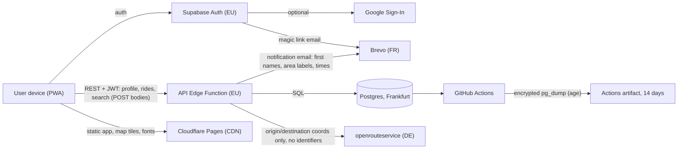

# Data Protection Impact Assessment (lightweight DPIA)

> Owner: software-architect · Date: 2026-11-15 · Status: Draft for GATE 3 (strategy P9, ADR 0005) · Review: before public launch, then every 12 months or on any change to location handling
> Controller: **[owner to provide: name / PFA / SRL, address]** · Contact: `privacy@haide.ro` · Supervisory authority: ANSPDCP (Romania)
> This is an engineering DPIA (GDPR Art. 35 structure). It is not legal advice. The recommended lawyer consult (strategy §13) should review it.

## 1. Why a DPIA

Haide processes **location and trip data** that reveal home, workplace and daily routines, matches strangers who then meet in person, and publishes ride listings openly (browse without an account). EDPB guidance treats mobility and location data as high-risk. Two Art. 35 screening criteria apply (location/behavioural data, data on a fairly large number of people over time in one city). A DPIA is required as good practice before launch.

## 2. Description of the processing

| Item | Description |
|---|---|
| Purposes | (1) Accounts and profiles. (2) Publishing rides and computing a cost-sharing price. (3) Matching passengers to rides. (4) Booking and putting the two parties in contact. (5) Trust and safety (ratings, reports, blocks, suspension). (6) Service emails. (7) Aggregate product metrics. (8) Security and abuse prevention |
| Data subjects | Adult users (18+ attested) acting as drivers and/or passengers. Visitors browsing without an account |
| Scale | Pilot target 500 users, 200 rides/week, Sibiu metro area |
| Recipients | Other users (limited by role, §4), processors (§5). No sale, no advertising, no third-party analytics |
| Transfers outside the EU | Data at rest stays in the EU (Supabase Frankfurt, Brevo FR). Cloudflare (US company) serves static files and processes visitor IPs through its global CDN, under its DPA and the EU-US Data Privacy Framework. Google processes sign-in only for users who pick Google |

### 2.1 Data inventory

| Category | Fields | Source | Lawful basis (P1) | Retention |
|---|---|---|---|---|
| Account | email, auth identifiers | user / Google | Contract 6(1)(b) | account lifetime. Deleted immediately on account deletion |
| Profile | first name, photo (re-encoded, no EXIF), phone, bio | user | Contract | account lifetime |
| Vehicle | make, model, colour, plate, fuel type, seats | user | Contract | account lifetime. Plate snapshot on rides scrubbed after 90 days |
| Consent records | document versions, timestamps, 18+ attestation | user | Legal obligation / legitimate interest (proof) | account lifetime + 3 years |
| Ride location | exact origin, destination, route polyline, labels | driver | Contract | exact for 90 days after departure, then 1 km grid + area label, route deleted |
| Booking location | snapped pickup/dropoff on the route, labels, walk distance | derived from passenger search | Contract | same as rides. **Raw typed origin/destination are not stored** |
| Search inputs | origin, destination, time | visitor/user | Contract (pre-contract steps) / legitimate interest for visitors | **not stored**. Only area labels and result counts in analytics |
| Device location | one-shot GPS fix on "Use my location" | device, on tap | **Consent** (browser permission) | not stored. Converted to a place immediately |
| Trust data | ratings, tags, no-show and late-cancel events, blocks | users / system | Legitimate interest 6(1)(f) (safety of users) | account lifetime. Ratings kept as "Deleted user" after deletion |
| Safety reports | reason, details, snapshot of reported first name + phone | users | Legitimate interest (safety, legal claims) | 12 months |
| Notifications | outbox rows (first names, labels, times) | system | Contract | 30 days |
| Analytics | event name, user id, area labels, counts | system | Legitimate interest (service improvement), no profiling | 13 months. User id nulled on deletion |
| Security | hashed IP (daily-rotating salt) in rate-limit counters, error reports (scrubbed) | system | Legitimate interest (security) | rate limits: hours. Errors: 14 days. Platform logs: 1 day (Supabase) |
| Backups | encrypted dump of the above | system | Legitimate interest (availability, Art. 32) | 14 days |

### 2.2 Data flows

## 3. Necessity and proportionality

| Principle | How Haide complies |
|---|---|
| Data minimisation | No surname, no ID documents, no background or live location, no GPS trails, raw search points not stored, no third-party analytics, map tiles and geocoding self-hosted (no per-user location sent to map vendors) |
| Purpose limitation | Location is used for matching, pricing and meeting only. No advertising or profiling. Analytics at neighbourhood granularity |
| Storage limitation | 90-day coarsening, fixed purge schedules (§2.1), automated daily job with a test proving no exact coordinates older than 90 days remain |
| Accuracy | Users edit their profile and vehicle at any time. Ride data is snapshotted per ride for fairness |
| Transparency | Privacy policy before sign-up and always reachable. Each hidden field says why in the UI (ia-and-flows principle 5) |
| Data subject rights | Access/portability: export on request (E6-4). Erasure: in-app deletion (E6-1). Rectification: profile editing. Objection: by email to `privacy@haide.ro`. Response ≤ 30 days |
| Security of processing | §6 |

## 4. Precision by role (what each party can see)

| Data | Public / visitor | Request pending | Confirmed, until departure + 24 h | Afterwards |
|---|---|---|---|---|
| Driver's origin/destination | area label + 300 m grid point. Route drawn with the first and last min(500 m, 10 %) trimmed | same | same (driver's home not needed) | area label |
| Pickup/dropoff | 300 m grid point + label | same | **exact snapped point** (both parties) | label |
| Phone, plate | never | never | **shown** | hidden |
| First name, photo, rating, counters | yes | yes | yes | yes |

## 5. Processors and third parties

| Party | Role | Data | Location | Basis / safeguard |
|---|---|---|---|---|
| Supabase Inc. | Processor (DB, auth, storage, functions, logs) | all service data | AWS eu-central-1 (Frankfurt) | DPA (Supabase), SCCs |
| Cloudflare Inc. | Processor (static hosting, DNS, email forwarding) | visitor IP, request metadata, forwarded support emails | global CDN | DPA, EU-US DPF, SCCs |
| Brevo (Sendinblue SAS) | Processor (email delivery) | email address, first names, area labels, times | EU (France) | DPA |
| HeiGIT gGmbH (openrouteservice) | Recipient of route queries | two coordinate pairs per ride preview, **no user identifiers, no IP of the user** (server-to-server) | Germany | Terms of service. Minimised so no personal data is linkable by the recipient |
| Google LLC | Independent controller for Google sign-in (only if the user chooses it) | Google account email, name, auth tokens | global | user's choice. Disclosed in the policy |
| GitHub Inc. | Processor (CI, encrypted backups) | encrypted backup blobs only (key held by the owner) | US/global | DPA. Ciphertext only |

Not used, by design: third-party analytics, ad networks, Google Fonts CDN, public map tile CDNs (except the documented OpenFreeMap fallback, which needs a policy update before it is enabled).

## 6. Risks and measures

Scale: Likelihood (L) and Severity (S) each 1–3. Risk = L × S (before → after measures).

| # | Risk to individuals | L×S before | Measures | L×S after |
|---|---|---|---|---|
| R1 | **Home address exposure** through public ride listings (a driver's route starts at home) | 3×3 = 9 | 300 m grid points, route trimming at both ends, labels at neighbourhood level, exact data only to confirmed parties within the time window | 1×2 = 2 |
| R2 | **Location probing** (repeated searches to triangulate a driver's start) | 2×3 = 6 | Deterministic grid (no extra information from repeated queries), 50 m rounding of walk distances, search rate limit 30/min, the 800 m threshold limits resolution, search requires a plausible ride window | 1×2 = 2 |
| R3 | **Stalking / harassment** after contact reveal | 2×3 = 6 | Phone and plate only after the driver approves, hidden after 24 h, report + block, suspension, 18+, share-trip link and 112 button (Should), public reliability counters | 1×3 = 3 |
| R4 | **Routine profiling** from long-term trip history (database breach or insider) | 2×3 = 6 | 90-day coarsening, route deletion, least-privilege DB role, no public schema exposure, encrypted backups with 14-day retention, admin UI never shows phones | 1×2 = 2 |
| R5 | **Data breach** via the API (broken authorization) | 2×3 = 6 | Central serializers, an integration test per endpoint for unentitled roles, deny-all RLS, pgTAP grant tests, qa-reviewer security checklist, dependency audit | 1×3 = 3 |
| R6 | **Leakage through side channels** (logs, emails, analytics) | 2×2 = 4 | Rules in conventions §6, coordinates only in POST bodies, scrubbed error reports, event payload test forbidding `lat/lng/phone/plate/email` keys, email template snapshot tests | 1×1 = 1 |
| R7 | **Photo metadata** reveals home location (EXIF GPS) | 2×2 = 4 | Client re-encode + mandatory server re-encode (test with a GPS-tagged JPEG) | 1×1 = 1 |
| R8 | **Minors** using the service | 2×3 = 6 | 18+ attestation stored, ToS, report reason "Fake profile", suspension | 2×2 = 4 (attestation only; ID verification out of scope) |
| R9 | **Inability to exercise erasure** | 2×2 = 4 | In-app deletion, immediate scrub + auth deletion, backups age out in 14 days (inside the 30-day promise) | 1×1 = 1 |
| R10 | **Third-party tracking** (map/geocoding vendors) | 2×2 = 4 | Self-hosted tiles and gazetteer, router called server-side with coordinates only | 1×1 = 1 |

**Residual risk: low to medium** (R3 and R8 stay the highest, as inherent to meeting strangers). No prior consultation with ANSPDCP is needed (Art. 36) if the measures are implemented as specified.

## 7. Breach response (Art. 33/34)

1. **Detect and contain** (revoke keys: Supabase secret key, DB role passwords, Brevo/ORS keys. Suspend the function deploy if needed).
2. **Assess** within 24 h: which data, how many users, risk level (use §6).
3. **Notify ANSPDCP within 72 h** of awareness if the breach is likely to result in a risk (via the dataprotection.ro online form). Notify affected users without undue delay if high risk (for example exact locations or phone numbers exposed).
4. **Record** every breach (even unreported ones) in `docs/ops/breach-log.md` (no personal data in git: incident id, dates, categories, counts, measures).

## 8. Implementation checklist (verified by qa-reviewer before GATE 3)

- [ ] Role-based serializers, with tests for every endpoint (data-model §5.2)
- [ ] Retention job + pgTAP "no exact geometry older than 90 days" (E6 backend: `app.coarsen_locations` in the tick, `app.location_retention_violations`, pgTAP 009 with the catalog guard; written, to be run in CI by qa-reviewer)
- [ ] Account deletion flow end to end (E6-1) (E6 backend: `DELETE /me`, `app.scrub_account`, purge queue; integration test `tests/integration/privacy.test.ts` incl. the leak scan)
- [ ] Photo re-encode test (EXIF/GPS removed)
- [ ] No coordinates/phones/plates in logs, events or emails (automated tests)
- [ ] CSP blocks third-party origins. No external fonts or scripts
- [ ] Privacy policy lists §2.1 purposes, bases and retention, §5 processors, rights, and the ANSPDCP contact. Controller identity filled in
- [ ] Consent records stored with versions. Re-acceptance on a version bump (E6 backend: `consent.reaccept`, terms 1.1, `POST /me/consents` without `age18`)
- [ ] Backups encrypted. Restore drill done once

## 9. Sign-off

| Role | Name | Date | Decision |
|---|---|---|---|
| Prepared by | software-architect (agent) | 2026-11-15 | Draft |
| Controller | [owner] | | Approve at GATE 3 |
| Legal review (recommended) | [lawyer] | | |
