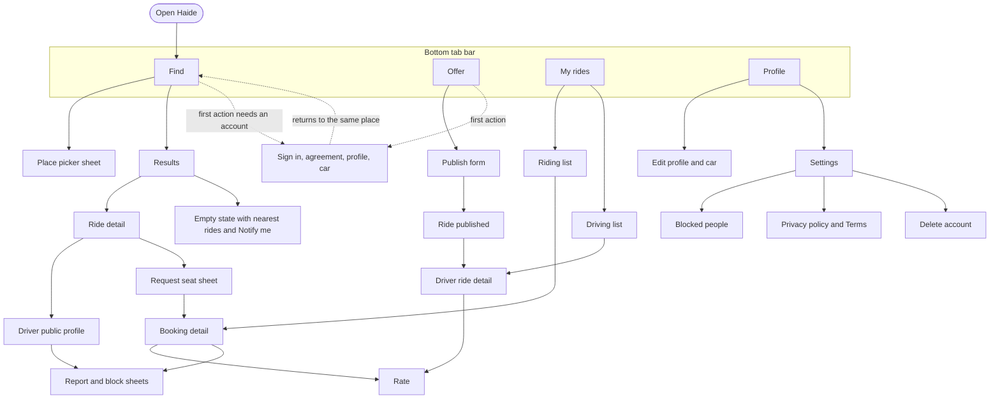
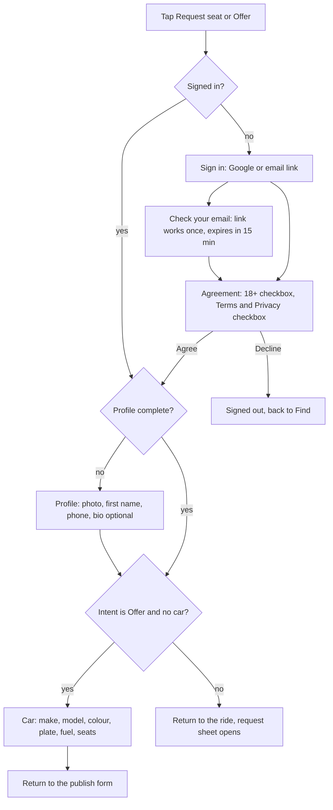
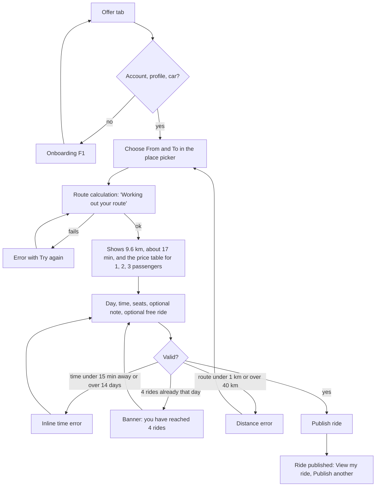
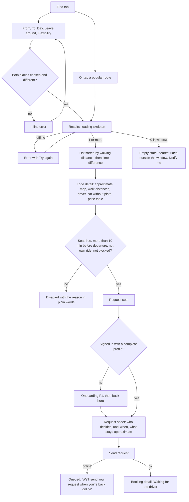
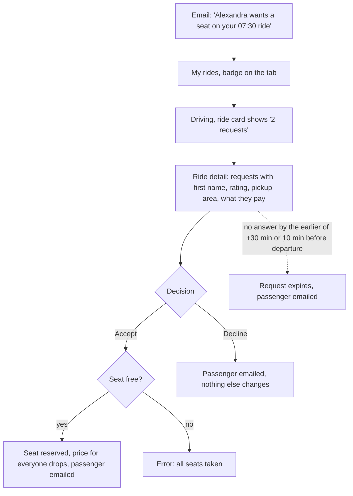
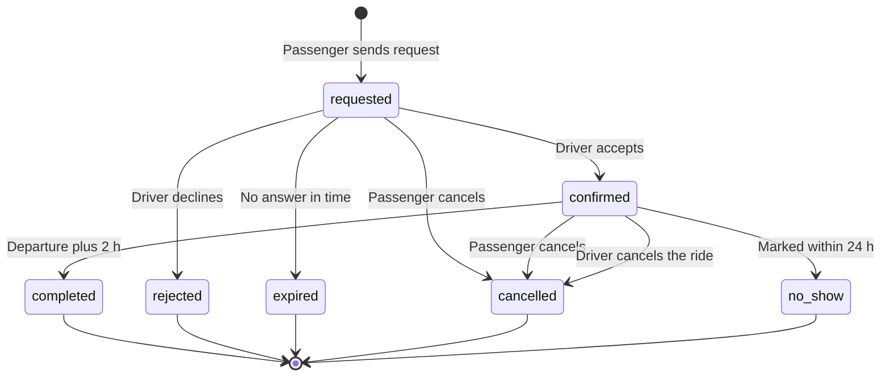
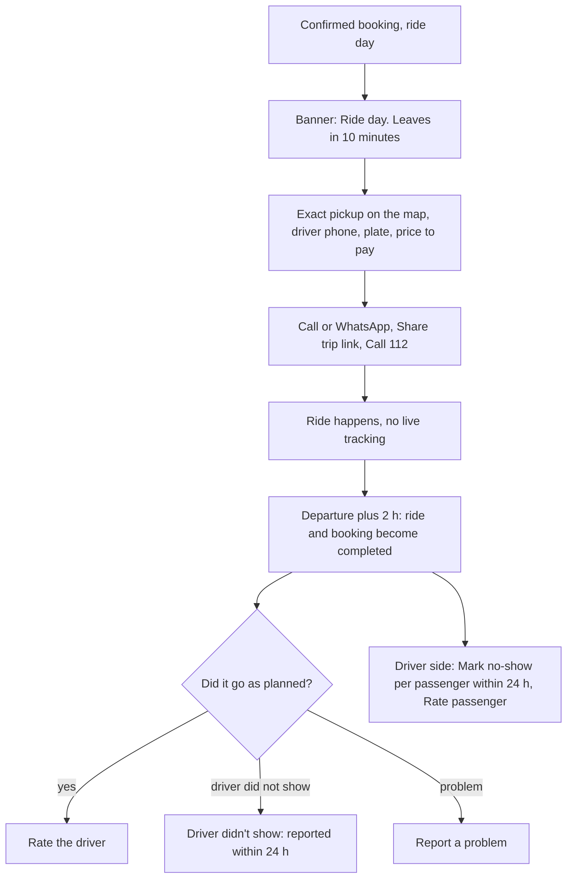
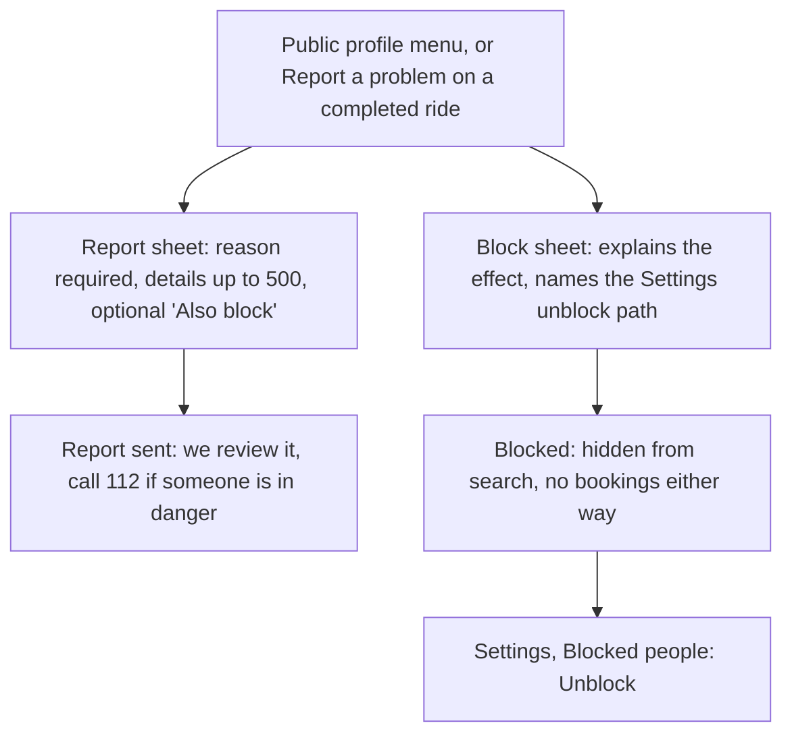

# Information architecture, flows and screen inventory

> Owner: ux-designer · Date: 2026-11-15 · Inputs: [mvp-scope](../product/mvp-scope.md), [backlog](../product/backlog.md), [pricing](../product/pricing.md), [strategy](../product/strategy.md), [brand-guide](../brand/brand-guide.md) · Prototype: [prototype/index.html](prototype/index.html) · Copy: [copy.md](copy.md) · Accessibility: [accessibility.md](accessibility.md)
> ADRs: [0008 navigation and IA](../decisions/0008-navigation-and-information-architecture.md) · [0009 request-then-approve UX](../decisions/0009-booking-request-then-approve-ux.md) · [0010 progressive onboarding](../decisions/0010-progressive-onboarding-and-gating.md) · [0011 price and money presentation](../decisions/0011-price-and-money-presentation.md)

## 1. Design principles (what every screen is judged against)

1. **One-handed on a 360 px phone.** Primary action in the lower half. Sheets rise from the bottom. No gestures required.
2. **Show value before asking for anything.** Search, results and ride details work signed out. Account is asked for at the moment of the first real action, and the user returns to exactly where they were.
3. **Specifics build trust.** A pickup point, a price, a plate, a rating count. No stock imagery.
4. **Say who decides and until when.** Request-then-approve is explicit on every screen that involves waiting.
5. **Precision by role.** Public views show approximate areas (about 300 m). Exact points, phone and plate appear only to the two people on a confirmed booking, and hide again 24 hours after the ride. The UI always says why something is hidden.
6. **The price is a promise that only goes down.** Cards say “Up to”. After acceptance the price is locked and can only fall. Money is never handled in the app, and the screen says so.
7. **The saffron dot marks the one thing that matters** (the pickup point, a price that dropped). Everything else is quiet.

## 2. Information architecture

### 2.1 Navigation model

A **bottom tab bar with four tabs** on the four root screens. Deeper screens hide the tab bar and show a back button, so the sticky action (Request seat, Send rating) has the whole bottom edge.

| Tab | Root screen | Contains | Signed-out behaviour |
|---|---|---|---|
| **Find** | Search form with popular routes | Results, ride details, request flow, driver profile | Fully usable |
| **Offer** | Publish form with live price preview | Publish confirmation | Explains the value and starts onboarding |
| **My rides** | Riding / Driving, Upcoming / Past | Booking detail, driver ride detail, rating | Sign-in prompt |
| **Profile** | Own profile | Edit profile, car, settings, blocked people, policies, delete account | Sign-in prompt |

There is **no passenger/driver mode switch**: one account does both. Role is a tab inside My rides, because a user can be a driver in the morning and a passenger in the evening. The My rides tab and the badge on it carry the pending-request count (driver) and unread status changes (passenger).

### 2.2 Where the account is required (gate table)

| Action | Needs | If missing |
|---|---|---|
| Search, view results, view ride details, view a public profile | Nothing | n/a |
| Request a seat | Account + consent + complete profile | Onboarding steps 1 to 3, then back to the same ride with the request sheet open |
| Offer a ride | Account + consent + complete profile + car | Onboarding steps 1 to 4, then back to the publish form |
| My rides, Profile | Account | Sign-in prompt in place |
| Report or block | Account | Sign-in first |

### 2.3 What each role sees and when (privacy matrix, ADR 0005)

| Data | Public (search, details) | Driver and the passenger, request pending | Both after acceptance, until 24 h after the ride | Afterwards |
|---|---|---|---|---|
| Pickup and drop-off | Area name, drawn as an approximate area on the map | Area (passenger). Driver sees the requester’s area | **Exact address, exact point on the map** | Neighbourhood label only |
| Phone number | Never | Never | **Shown with Call and WhatsApp** | Hidden |
| Number plate | Never (“shows after you’re accepted”) | Never | **Shown to the passenger** | Hidden |
| First name, photo, rating | Yes | Yes | Yes | Yes |
| Surname | Never collected | | | |

## 3. User flows

### F1. Account and onboarding (E1, E6-3)

Progressive, with a step counter that says 3 steps for passengers and 4 for drivers. Back-navigation never shows protected screens after sign-out (E1-6).

Edge cases: magic link expired or reused (message plus “Send a new link”). Photo over 5 MB (inline error). Phone not a Romanian mobile (inline error with an example). Plate format error. Terms version bump asks for re-acceptance at next sign-in (E6-3). A suspended account sees the paused-account message on protected actions (E5-5).

### F2. Driver publishes a ride (E2-1, E2-2, E2-6)

The driver sees: the price per passenger by number of passengers, what they recover (“With 3 passengers you recover about 4.50 RON of the 6.24 RON fuel cost”), and that the price is set by Haide and cannot be raised. There is no price field. The “Offer for free” switch lowers the price to zero. “Repeat on weekdays” is shown as **Coming soon** (E8-1 slot).

### F3. Passenger searches and requests a seat (E3, E4-1)

### F4. Driver answers a request (E4-2, E4-3)

### F5. Booking lifecycle and cancellation (E4)

States use the domain glossary: `requested → confirmed → completed`, or `rejected`, `expired`, `cancelled`, `no_show`. The rider-facing labels are in [copy.md](copy.md) under Status labels.

| Event | What each side sees |
|---|---|
| Passenger cancels a confirmed booking more than 30 min before departure | Driver is emailed. Remaining prices are recalculated and **never rise**. No counter change |
| Passenger cancels within 30 min of departure | The sheet warns: “Cancelling within 30 minutes of departure counts as a late cancellation on your profile.” Counter on the public profile goes up |
| Driver cancels the ride | Confirm sheet states how many passengers will be emailed, plus the same late warning. Passengers see “Radu cancelled this ride” and a Find another ride button |
| Another passenger joins | Everyone’s price drops. The passenger sees a green banner “Price dropped to 1.90 RON because another passenger joined.” and the saffron dot pulses once |
| Request unanswered | Status becomes Expired. The passenger sees “Radu didn’t answer in time. Try another ride.” |

### F6. Ride day (E4-5, E5-1, E5-2, E5-6, E5-7)

Call 112 appears from 15 minutes before to 2 hours after departure (Should). Share trip link opens a sheet with a read-only link that stops working 24 hours after the ride (Should). Payment is a line, not a flow: “In cash or by transfer when you meet. Haide doesn’t handle money.”

### F7. Rating (E5-3)

Rate within 7 days. 1 to 5 stars and optional tags (driver tags: Punctual, Friendly, Safe driving, Clean car. Passenger tags: Punctual, Friendly, Respectful, On time at pickup). Ratings are final and **blind**: the person sees it once both have rated or 7 days passed. A no-show booking cannot be rated. The entry points are the booking detail (passenger), the driver ride detail (per passenger), and the My rides card.

### F8. Report and block (E5-4)

The reported person is never told. Reasons: Didn’t show up, Unsafe driving, Harassment, Asked for extra money, Fake profile, Other. “Asked for extra money” exists because a driver asking for more than the shown price is the main legal and trust risk (pricing §7).

### F9. Account, privacy and deletion (E1-6, E6)

| Task | Where | Notes |
|---|---|---|
| Edit profile | Profile, Edit profile | Same form as onboarding. Changing the car never changes already published rides |
| See how others see me | Profile, See how others see you | Shows the public profile without phone, plate or surname |
| Read Privacy policy and Terms | Settings, also linked from the agreement step and signed out | Versioned. Re-acceptance on a new version |
| Request a copy of my data (Should) | Settings | Toast “Request sent. We’ll email your data within 30 days.” |
| Blocked people | Settings | Unblock per person |
| Delete account | Settings, Delete account | Full screen (not a sheet) that lists the consequences in 3 lines before the red button. Future rides and bookings are cancelled and counterparts told. Data erased within 30 days. Ratings remain as “Deleted user”. Reports kept 12 months |
| Sign out | Profile | Clears the session. Back does not reveal protected screens |

## 4. Screen inventory

Legend: **P** = built in the prototype, **S** = specified here and in copy.md but not drawn. States: E empty, L loading, X error, S success. Route names are from the prototype and can change in the build.

### E1 Accounts, profile, vehicle

| # | Screen | Route | Purpose | Key components | States | Edge cases | |
|---|---|---|---|---|---|---|---|
| 1.1 | Sign in | `#/auth` | Start or resume an account | Google button, email field, helper text, close | X invalid email | Opened from a gated action: subtitle names the action | P |
| 1.2 | Check your email | `#/auth/check` | Magic link instructions | Mail icon, address, Send a new link, Use a different email | S link re-sent | Link expired or used: “This link has expired or was already used.” | P |
| 1.3 | Agreement | `#/auth/consent` | 18+ and Terms and Privacy (E1-2) | Progress, two checkboxes with separate errors, links to policies, Decline | X each box | Decline signs out. Checkbox state survives a trip to the policy page | P |
| 1.4 | Profile setup | `#/setup/profile` | Complete profile (E1-3) | Photo picker, first name, phone, bio with counter | X name, phone, photo, photo size | Diacritics in names accepted. Photo has EXIF removed server side | P |
| 1.5 | Car | `#/setup/vehicle`, `#/profile/car` | Vehicle for recognition and the fuel rate (E1-4) | Make, model, colour, plate, fuel select, seats select | X required, plate | One car per user. Editing does not change published rides | P |
| 1.6 | Public profile | `#/user/:id` | Decide whether to ride with someone (E1-5) | Avatar, name, rating or “New to Haide”, member since, rides completed, late cancellations, no-shows, bio, menu (report, block) | “New” when under 3 ratings | Never phone, plate, surname. Own profile has no menu | P |
| 1.7 | Own profile | `#/profile` | Hub | Avatar, list rows (public view, edit, car, settings), Sign out | Signed out: join card | Car row says “No car added yet” | P |

### E2 Publish and manage rides

| # | Screen | Route | Purpose | Key components | States | Edge cases | |
|---|---|---|---|---|---|---|---|
| 2.1 | Offer gate | `#/offer` | Explain and start onboarding | Value line, Add car / sign-in button | Needs car, needs account | | P |
| 2.2 | Publish form | `#/offer` | Publish a ride (E2-1) | From and To buttons, route result, day and time, seat stepper, note, price table, free switch, repeat (Coming soon), Publish | L route, X route fail, X time, X day limit, X same place | Time under 15 min away. Seats limited to the car. Day limit of 4 | P |
| 2.3 | Place picker | sheet | Choose a place | Search input, Use my location, Choose on map, suggestions, live result count | E “No match for …”, L locating, X permission denied | Diacritics-insensitive. Location used once, foreground only. Map pin is S | P (map pin S) |
| 2.4 | Ride published | `#/offer/done` | Confirm and next step | Success icon, summary, View my ride, Publish another | S | | P |
| 2.5 | Driving list | `#/rides` (Driving) | See my rides (E2-3) | Ride cards with time, route, status, seats taken, request badge | E “You haven’t offered a ride yet” | Past tab shows completed, expired, cancelled | P |
| 2.6 | Driver ride | `#/driving/:id` | Manage one ride | Exact map, route, price table and recover line, requests, passengers with Call and WhatsApp, Cancel ride, Call 112 | E no requests, X all seats taken | Cancel within 30 min warns. After the ride: Mark no-show, Rate | P |
| 2.7 | Cancel ride | sheet | E2-4 | Consequence line with passenger count, late warning | | | P |

### E3 Search and matching

| # | Screen | Route | Purpose | Key components | States | Edge cases | |
|---|---|---|---|---|---|---|---|
| 3.1 | Find | `#/find` | Search and entry for visitors | Hero with the route motif, From and To, swap, day, time, flexibility chips, Search, popular routes | X missing, X same place | Popular routes mirror the 3 launch corridors | P |
| 3.2 | Results | `#/results` | Ranked rides (E3-2) | Summary with Edit search, sort note, ride cards | L skeleton, E empty with nearest rides and Notify me, X offline with Try again | Blocked drivers hidden with a note. Card shows “Up to X RON”, walk distances, driver, rating, seats | P |
| 3.3 | Ride detail | `#/ride/:id/:variant` | Decide (E3-3) | Approximate map, area label, walk distances, driver card, car without plate, note, price table, pay-directly line, sticky Request seat | X gone, disabled reasons: full, own ride, already requested, too late, blocked | Plate locked row explains why | P |
| 3.4 | Notify me | in empty state | Capture unmet demand (E8-2 slot) | Button then saved state | S saved | Max 5 alerts, 14 days. Prototype stores one | P (E8) |

### E4 Booking lifecycle and notifications

| # | Screen | Route | Purpose | Key components | States | Edge cases | |
|---|---|---|---|---|---|---|---|
| 4.1 | Request sheet | sheet | Send a request (E4-1) | Summary, “Up to” price, three plain lines, Send request | L sending, X offline queued | Closed less than 10 min before departure | P |
| 4.2 | Booking detail | `#/booking` | One screen for the booking in all states (E4-3, E4-4, E4-5, E4-7) | Status banner, timeline, map, route, price card, contact card, Share trip, Call 112, Cancel | requested, confirmed, rejected, expired, cancelled, ride cancelled, completed, no-show | Exact data only when confirmed and until 24 h after. Price dropped banner. Queued request note | P |
| 4.3 | Cancel booking | sheet | E4-4 | Consequence, late warning, Cancel booking / Keep my seat | | Late window 30 min | P |
| 4.4 | Riding list | `#/rides` (Riding) | Booking cards with status and unread badge | | E “No rides booked yet” | Past holds rejected, expired, cancelled, completed | P |
| 4.5 | Notification emails | email | E4-6 | Subject, one sentence, neighbourhood labels only, one link | | No exact address, phone or plate in any email | S (copy in copy.md) |
| 4.6 | In-app badges | tab bar | Show pending requests and status changes | Count badge with hidden text | | | P |

### E5 Completion, ratings, safety

| # | Screen | Route | Purpose | Key components | States | Edge cases | |
|---|---|---|---|---|---|---|---|
| 5.1 | Rate | `#/rate/driver`, `#/rate/p/:id` | Mutual rating (E5-3) | Star radio group, tag chips, window note, Send rating | X no stars, S done (“sees it once you’ve both rated”) | Blind rating. Immutable. Not for no-show bookings | P |
| 5.2 | Report | sheet | E5-4 | Reason radios, details with counter, Also block | X no reason, S sent | The reported person is not told | P |
| 5.3 | Block | sheet | E5-4 | Effect text, Block / Don’t block | S toast | Unblock in Settings | P |
| 5.4 | No-show | sheet | E5-2 | Consequence, Mark no-show / Not a no-show. Passenger side: Driver didn’t show | S toast | Within 24 h only | P |
| 5.5 | Share trip link | sheet | E5-6 (Should) | Explanation, link, Copy link | S copied | Expires 24 h after the ride | P |
| 5.6 | Call 112 | button | E5-7 (Should) | Red button that dials | | 15 min before to 2 h after departure | P |
| 5.7 | Suspended | banner on protected actions | E5-5 | Plain message, support contact | | | S |

### E6 Privacy and compliance

| # | Screen | Route | Purpose | Key components | States | Edge cases | |
|---|---|---|---|---|---|---|---|
| 6.1 | Settings | `#/settings` | Hub | Notifications, language, blocked people, privacy rows | | Push shows “Coming soon” | P |
| 6.2 | Privacy policy, Terms | `#/policy/privacy`, `#/policy/terms` | E6-3 | Version line, four short paragraphs, controller placeholder | | Reachable signed out | P (summary) |
| 6.3 | Blocked people | `#/settings/blocked` | Unblock | List with Unblock | E “You haven’t blocked anyone.” | | P |
| 6.4 | Delete account | `#/delete` | E6-1 | Three consequence lines, Delete account, Keep my account | S toast and sign-out | | P |
| 6.5 | Request my data | Settings row | E6-4 (Should) | Toast | | | P |

### E7 Metrics and admin (desktop-first, not a passenger surface)

Not drawn. These are protected pages for the owner and the maintainer, used on a laptop. Spec for `frontend-dev`:

| # | Screen | Purpose | Layout | Notes |
|---|---|---|---|---|
| 7.1 | Metrics (E7-2) | Per ISO week: completed shared seats (North Star), match rate overall and per corridor, fill rate, median response time, 4-week retention, reports per 100 rides, cancellation rate | Week selector, one large North Star number with sparkline, then a grid of seven metric tiles each with value, target and the kill threshold as text | Use the metric names from mvp-scope §4. Tables need a text alternative for any chart |
| 7.2 | Reports queue (E7-3, Should) | Triage | Table: reporter, reported user, reason, ride link, date. Row actions Dismiss, Suspend, Unsuspend, each with a confirm and an audit-log line | Never shows phone numbers |
| 7.3 | Energy prices (E7-4, Should) | Add a price config version | Form with fuel type, price, reference consumption, effective date. Warns when the change is over 30% | Server validates, UI only mirrors |

## 5. Rules the UI mirrors (the server enforces them, G1)

| Rule | Where the UI shows it |
|---|---|
| Publish at least 15 min and at most 14 days ahead | Inline time error |
| 4 rides per driver per day | Banner on the publish form |
| Seats 1 to 4, not above the car | Stepper limit |
| Ride 1 to 40 km | Distance error |
| Request closes 10 min before departure | Disabled button with reason |
| One request per ride per passenger | “You already have a seat on this ride” |
| Request expires at the earlier of +30 min or 10 min before departure | Clock time on every waiting screen |
| Price only goes down after acceptance | “Your price can only go down.” and the dropped banner |
| Rating within 7 days, final, blind | Rating screen copy |
| No-show within 24 h | No-show sheet copy |
| Late cancellation is within 30 min of departure | Cancel sheets |

## 6. E8 slots reserved in the layout

| Feature | Reserved space |
|---|---|
| E8-1 Recurring rides | A switch row “Repeat on weekdays” on the publish form, disabled with a Coming soon chip |
| E8-2 Ride alerts | “Notify me about this route” on the empty state (works in the prototype) and a future Alerts row in Settings |
| E8-3 Auto-accept | A future switch on the publish form under the note |
| E8-4 Web push | “Push notifications: Coming soon” in Settings. The opt-in prompt appears only after the first booking or ride |
| E8-5 Fuel saved | A future line under the profile header |

## 7. Self-critique (design-critique pass)

| Finding | Severity | Action |
|---|---|---|
| Ride card packed time, route and price into 3 columns, and the route wrapped to 4 lines at 360 px | High | Fixed: time and price on top, route full width |
| Find screen opened with a bare form. The one memorable element (the saffron route line) was missing | Medium | Added the dusk hero with the route motif and the logo, and popular routes as tappable corridor shortcuts |
| Native radio buttons appeared inside custom chips | Medium | Fixed: native input hidden, check mark on the chip |
| Price said “Up to” in the list but the confirmed price was lower with no explanation | Medium | Added the “Drops if others join” line on cards and a saved-price banner after acceptance |
| Saffron was only a dot. Risk of using it as decoration elsewhere | Low | Rule kept: saffron only marks pickup points, count badges and the price-drop pulse |
| Two levels of tabs in My rides are dense | Low | Kept because it maps to role then time. Revisit if testing shows confusion. The default view is the one with content |

What works and stays: the bottom-sheet request flow (context stays visible), the route rail used on every screen that shows a trip, status always as icon plus word, and the single “Request seat” label from button to status.

## 8. Prototype notes

- One self-contained file, no network. Fonts embedded (Sora and Figtree, latin and latin-ext, so ș ț ă â î render). Strings come from the same keys as [copy.md](copy.md). **E-DM update:** the prototype now uses the dark-first "Headlight" look (ADR 0016 to 0020) with all eight motion moments from [motion.md](motion.md). It is built from `prototype/src/*` by `node docs/ux/prototype/tools/build-prototype.mjs`; do not edit `index.html` by hand. The demo panel adds Dark/Light, Reduce motion and Next minute. The flows above are unchanged, except: the request is sent with the launch moment, ride day shows the live trip card (schedule-driven, no GPS), and the driver's screen makes only the next request or rating a primary action.
- A **Demo controls** button in the top bar switches persona (Visitor, Ioana, Andrei), jumps the clock (06:42, 07:15, 09:40) and triggers what happens next (driver accepts or declines, another passenger joins, driver cancels), plus Offline and Daily limit.
- Prices are computed in the prototype with the formula and config v1 from [pricing.md](../product/pricing.md) so the screens show correct numbers (Trip B shows 3.10, 2.00, 1.50). The real app computes them **server-side only**.
- The map is a drawing. Approximate areas are dashed circles, exact points are solid. The build needs a real map with the same two modes.
- Simplifications: one booking at a time, results ignore the date, “Choose on map” is stubbed, the notification email is shown as copy only.
